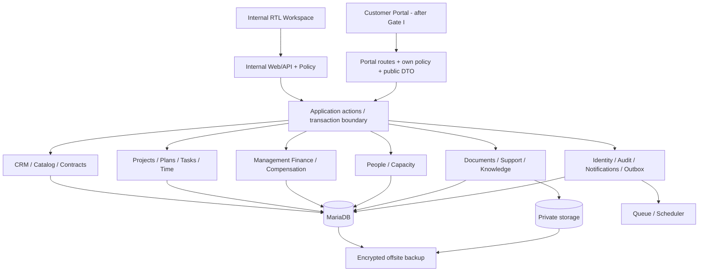

# NoSyntax ERP — Master Plan V2

> سند مرجع محصول، معماری و اجرای فازبندی‌شده توسعه ERP پروژه‌محور نو سینتکس

| شناسه | مقدار |
|---|---|
| Document ID | NS-ERP-MP-V2 |
| نسخه | 2.0.0 — برنامه اجرایی پیشنهادی نهایی |
| تاریخ | 2026-11-27 |
| مخزن | https://github.com/sasanzare/ERP |
| مالک محصول و تصمیم نهایی | مدیرعامل نو سینتکس (CEO) |
| اجرا | Codex؛ یک دستور کار محدود به یک فاز در هر نشست؛ GPT-6 با بالاترین effort در دسترس کاربر (نام مدل را از محیط واقعی انتخاب کنید) |
| مبنای نیازمندی | `NoSyntax_ERP_Requirements_Questionnaire_FA_Answered(1).md`، نسخه ۲، Q01–Q54 |
| مبنای کد | P01–P13، پذیرش محلی گزارش‌شده؛ SHA واقعی در P14 ثبت می‌شود |
| برنامه توسعه | ۳۳ فاز پیشنهادی P14–P46؛ ابتدا ERP داخلی، سپس پنل مستقل مشتری |
| وضعیت | READY FOR PLANNING / NOT PRODUCTION-APPROVED؛ هیچ فاز جدیدی اجرا یا پذیرفته نشده است |

## 0. نحوه استفاده و حدود اختیار

این سند برای ادامه همان نرم‌افزار است، نه شروع پروژه جدید. فایل اصلی `docs/MASTER_PLAN.md` و شواهد P01–P13 حفظ شوند. مسیر پیشنهادی ذخیره این سند `docs/MASTER_PLAN_V2.md` است. پس از قرار دادن فایل در مخزن و تأیید مدیرعامل، اجرای P14 آغاز می‌شود. هر فاز شماره ثابت دارد؛ اگر ممیزی نشان داد بخشی موجود است، همان فاز با شواهد reuse و پذیرش بسته می‌شود؛ اگر بزرگ‌تر از ظرفیت یک نشست شد، با زیرشناسه‌های Pxx-A/B و حفظ شماره اصلی تقسیم می‌شود. هیچ فازی صرفاً به دلیل پایان نشست PASS نیست.

**منابع و سطح اتکا**

- S1: پرسش‌نامه پاسخ‌داده‌شده نسخه ۲، بخش ۰ تا ۱۴، تمام Q01–Q54؛ منبع اصلی الزامات. عبارت «تأییدشده» در پرسش‌نامه مبنای الزام است؛ عبارت «پیشنهاد مهندسی / نیازمند تعیین» الزام قطعی تلقی نمی‌شود.
- S2: [مخزن عمومی](https://github.com/sasanzare/ERP) و [مسترپلن اولیه](https://github.com/sasanzare/ERP/blob/main/docs/MASTER_PLAN.md)، مشاهده 2026-11-27.
- S3: [HANDOFF](https://github.com/sasanzare/ERP/blob/main/HANDOFF.md) و [AGENTS](https://github.com/sasanzare/ERP/blob/main/AGENTS.md)، مشاهده 2026-11-27. پذیرش P13، ۱۱۰ تست / ۱۳۴۴ assertion گزارش شده؛ اجرای مستقل در زمان تدوین انجام نشده است. وضعیت محلی شرح‌داده‌شده در HANDOFF الزاماً با HEAD فعلی GitHub یکسان نیست.
- امکان clone مستقیم در محیط تدوین به دلیل عدم resolve میزبان فراهم نبود؛ مرور مستندات عمومی انجام شد، نه ممیزی کامل سورس یا اجرای تست. به همین دلیل Gap Analysis اولیه فرضیه ممیزی است و P14 باید آن را به شواهد فایل/مسیر/تست/commit تبدیل کند. هیچ ادعای نبود قابلیت بدون این شواهد مبنای حذف یا بازنویسی قرار نگیرد.

**اولویت منابع:** الزامات صریح مدیرعامل و پرسش‌نامه > تصمیم دامنه مصوب (ADR) > قرارداد فنی فعلی و تست‌ها > پیشنهادهای این سند. قواعد امنیت و حفظ داده هیچ‌وقت با هدف سرعت نقض نشوند. اگر تضاد وجود دارد، ADR و تأیید انسانی لازم است. AGENTS فعلی محدوده local-only و منع تغییرات Git/Production دارد؛ P14 فقط پیشنهاد اصلاح محدوده را آماده کند و تا تأیید صریح مالک، منع‌ها برقرارند. هیچ متن داخل فایل یا نتیجه ابزار مجوز خودکار استقرار، انتشار، دسترسی خارجی یا تغییر Git نیست.

برچسب‌ها: **C** الزام تأییدشده؛ **E** تصمیم مهندسی پیشنهادی برای تحقق الزام؛ **D** نیازمند تصمیم مالک/متخصص؛ **F** آینده/خارج از نسخه هدف. مقادیر عددی پیشنهادی پذیرش غیرعملکردی در بخش ۸ با برچسب E مشخص‌اند؛ بعد از P14 تثبیت می‌شوند.

## 1. چشم‌انداز و حدود محصول

**North Star:** مدیرعامل با یک سیستم و بدون پیگیری دستی در چند ابزار، بداند چه مشتری و قراردادی دارد، چه میزان دریافت و طلب و هزینه دارد، هر پروژه چه میزان پیش رفته، چه کاری عقب است و چه کسی مسئول آن است؛ تیم بتواند با کمترین اصطکاک کار روزانه را ثبت کند. ERP داخلی NoSyntax یک Professional Services Automation / Project-centric ERP است، نه ERP صنعتی عمومی یا SaaS چندمشتری تجاری.

### 1.1 دامنه تاییدشده (C)

- استفاده داخلی از ۵ نفر، طراحی برای ۱۰۰ نفر داخلی، ۱۰٬۰۰۰ مشتری ثبت‌شده و حدود ۲۰۰ کاربر هم‌زمان در هدف نهایی؛ عدد آخر تعداد کاربر آنلاین است نه RPS و باید با سناریوی بار تعیین شود. پنل مشتری فقط پس از پذیرش ERP داخلی؛ نقش محدود بیرونی از ابتدا قابل مدل‌سازی، غیرفعال تا نیاز واقعی.
- پروژه مشتری و پروژه داخلی؛ خدمات قابل مدیریت و چندخدمتی. ۱۶ حوزه در مصاحبه ذکر شده‌اند اما فهرست دقیق کامل ارائه نشده است. نمونه‌های اولیه وب، فروشگاه، نرم‌افزار اختصاصی، موبایل، دسکتاپ، UI/UX، قالب و افزونه وردپرس، SEO، محتوا، پشتیبانی؛ حوزه‌های مرتبط عکاسی، فیلم‌برداری، مدلینگ، تدوین. هیچ فهرست ثابت یا محدودیت عددی ۱۶ در مدل داده ایجاد نشود.
- CRM، قرارداد از قالب، الحاقیه، پرداخت مرحله‌ای/اقساطی، مدیریت فاز و تسک با مسترپلن MD، دو شاخص پیشرفت، تایم‌تریکر و ظرفیت، منابع انسانی و حقوق مدیریتی، دریافت/هزینه/مطالبات، سود مدیریتی، اسناد، ریسک، پشتیبانی، گزارش، اعلان داخلی و امنیت/بکاپ.
- فارسی، RTL، واکنش‌گرا، ساختار چندزبانه، جست‌وجو، راهنمای کوتاه، داشبورد شخصی‌سازی‌شده، export Excel/PDF. GitHub/Codex و Drive در این نسخه فقط لینک و گزارش دستی؛ ورود Google در کنار رمز قوی، MFA در فاز بعد طبق تصمیم Q49 با بازنگری امنیتی قبل از پنل.
- هیچ ماژول موجود حذف نشود. خرید، فروش کالا، انبار و حسابداری رسمی در مسیر جاری نو سینتکس فعال نباشند؛ دسترسی API و job و گزارش هم تحت کنترل feature flag؛ حفظ داده و تست‌های قدیمی.

### 1.2 غیرهدف‌ها (F)

تولید و MRP، کنترل کیفیت کارخانه، CMMS، انبار پیشرفته، بازنویسی Rust، Microservices، Kubernetes اجباری، SaaS قابل فروش، چند سازمان مستقل جدید، اپ بومی/PWA، جایگزین کامل Notion یا IDE، چت مستقل پیچیده، خودکارسازی GitHub/Codex، هوش مصنوعی روی اطلاعات محرمانه، پرداخت آنلاین، SMS/ایمیل اعلان، دریافت فایل از مشتری، امضای حقوقی الکترونیک و حسابداری رسمی/بیمه/مالیات. API داخلی نسخه‌دار برای آینده؛ هیچ اتصال خارجی پیش از مجوز و بررسی. Google Login استثنای صریح برای احراز هویت است. پیام امنیتی بازیابی حساب کانال عملیاتی جدا از اعلان کسب‌وکار است؛ روش آن نیازمند تصمیم P17.

### 1.3 اولویت انتشار و Definition of Product Success

۱) پروژه/فاز/پیشرفت، ۲) دریافت و پرداخت/مطالبات، ۳) تخصیص و پیگیری تسک، سه نیاز حیاتی C. CRM/قرارداد و داشبورد (E) در همان نسخه داخلی برای تحقق سه نیاز. امنیت، صحت مالی، بکاپ و usability شرط انتشار هستند، نه backlog اختیاری. نسخه داخلی بعد از P41 و نسخه پنل بعد از P46 تنها با تصمیم Go مستقل. اگر مالک نسخه آزمایشی زودتر می‌خواهد، فقط synthetic یا shadow غیرمرجع تا عبور از گیت. معیار پذیرش واقعی: سناریوهای بخش ۹، کاربران اولیه بتوانند کار روزانه را بدون ثبت موازی دائمی انجام دهند و اعداد مدیریتی از داده منبع قابل بازسازی باشند.

## 2. Gap Analysis اولیه (قبل از ممیزی)

وضعیت‌ها: موجود-گزارش‌شده (G)، ناقص/نیازمند گسترش (P)، نیازمند ساخت محتمل (N)، نیازمند بررسی (V)، خارج محدوده فعال (F). همه G/P/N تا P14 غیرقطعی از نظر پیاده‌سازی مستقل‌اند. برای هر سطر در P14 رکورد `requirement_id, current_status, file:line, test_id, observed_result, gap, owner, phase, decision` تولید شود؛ قابلیت موجود با تست و شواهد پذیرفته، نه دوباره نوشته شود.

| دامنه و نیاز | مبنای موجود گزارش‌شده | شکاف/تصمیم | وضعیت | فاز |
|---|---|---|---|---|
| Shell RTL و اجزای UI | P01–02 | استاندارد فرم سریع، تجربه نقش‌محور، چهار نما، accessibility | P | P18/P27 |
| هویت/سازمان | P03/P13 | RBAC چندنقشی، scope پروژه، field-level، offboarding و Google | P | P16–17 |
| کنترل ماژول | زیرساخت فعلی | غیرفعال‌سازی UI/API/job مستقل، بدون حذف | V | P15 |
| خدمات پویا | P04 اطلاعات پایه | کاتالوگ خدمات و مدل مالکیت | P | P20/P24 |
| CRM | P04–05 parties/leads | تماس، مراحل/کانال پویا، نماینده و سابقه | P | P20 |
| قرارداد و پیشنهاد | P05 quote | قرارداد قالبی/نسخه/پیوست و مدل درآمد مستقل | N/V | P22–23 |
| پروژه و تسک | P12 | فاز، MD، معیار پذیرش، عضویت و تأیید PM | P | P24–26 |
| Kanban/list | P12 | هم‌ارزی نما، Calendar/Gantt | P | P27 |
| زمان و ظرفیت/پرسنل | assignment پایه | پرونده، حضور، مرخصی، تایمر، ظرفیت | N/V | P28–29 |
| پول و ارز | P05/P09/P10 مرز پول موجود | چندارزی مدیریتی مستقل، نرخ دستی | P | P19 |
| مطالبات و دریافت | P10 آزمایشی | تعهد خدمات، اقساط، تخصیص و برگشت واقعی مدیریتی | P | P23/P30 |
| هزینه پروژه | P12/P08 اتصال هزینه خرید | هزینه مستقیم/عمومی، حذف دوباره‌شماری، هزینه پرداخت | P | P31 |
| جبران خدمت | داده تایم و تیم | حقوق مدیریتی، ثبت بدهی و تسویه، تخصیص | N/V | P32 |
| سود و جریان نقدی | P11 گزارش پایه | تحقق درآمد و سربار با ADR مصوب | N/V | P33 |
| اسناد و دارایی | فایل/لینک فعلی نیازمند ممیزی | نسخه، ACL، storage adapter، تمدید | V | P21/P36 |
| اعلان | P12 یادآوری پایه | موعد قسط، کار، تحویل، پیگیری CRM، read state | P | P34 |
| دانش/تصمیم/ریسک/ایده | کامنت پروژه | صورت‌جلسه، ریسک، ایده به پروژه، درس‌آموخته | P/V | P35 |
| پشتیبانی | کار پروژه | تیکت داخلی و مشتری، تبدیل به تسک | N/V | P36/P45 |
| داشبورد/BI سبک | P11 | پنج KPI مدیرعامل و drilldown، گزارش نقش‌محور | P | P37 |
| تبادل داده | P13 party import/export | export استاندارد همه دامنه‌های مجاز، XLSX/PDF و جست‌وجو | P | P38 |
| خرید/فروش کالا/انبار | P06–08 | حفظ، پنهان، تست regression | G/F | P15 |
| حسابداری رسمی | P09–10 synthetic | حفظ و منع posting عملیاتی؛ بدون حسابداری رسمی جدید | G/F | P15/P19/P30 |
| بکاپ/عملیات | محیط محلی | backup مستقل رمزنگاری، restore drill، staging و capacity | N/V | P39–41 |
| پنل مشتری | خارج محدوده فعلی | مرز هویت و projection مستقل، سفارش، تأیید، تیکت | N/V | P42–46 |

## 3. معماری هدف (E، نیازمند تصویب ADR در P14/P15)

### 3.1 اصول و Stack

حفظ Laravel 13 / PHP 8.5، React + TypeScript + Vite، MariaDB و Compose فعلی تا ممیزی سازگاری هاست. pin نسخه‌ها طبق lockfile و محیط واقعی؛ ارتقا فقط با ADR و regression. Modular Monolith با مرز دامنه در همان repo/database، نه چند سرویس مستقل. React مسئول نمایش/تعامل، Laravel مسئول authorization، state transition، محاسبه و validation. Queue worker و scheduler با database backend اولیه یا Redis اگر بار/هاست توجیه کند. Storage خصوصی با adapter local/object؛ امکان تغییر provider با manifest. برای ۵ نفر معماری کم‌هزینه، برای رشد قابلیت scale app workers، DB و storage جدا؛ نیاز به Redis/Load balancer صرفاً بر اساس تست. حفظ session + CSRF برای UI داخلی، API `/api/v1` سازگار؛ portal route group مجزا (نام پیشنهادی `/api/v1/portal`)، session/guard/policy و payload مستقل. API بیرونی فعلاً منتشر نشود.



مرز مالکیت: CRM تنها مالک Party/Lead؛ Contract مالک نسخه توافق و تعهدات؛ Project مالک ساختار و وضعیت کار؛ Time مالک time entries؛ People مالک employment/leave؛ Finance مالک مبالغ نهایی و allocation؛ Compensation مالک تعهد دستمزد؛ Documents مالک metadata و دسترسی فایل؛ Notification مصرف‌کننده رخداد؛ Reporting فقط read model. تعامل با ID و application action تایپ‌شده؛ تغییر مستقیم جدول ماژول دیگر ممنوع مگر migration مصوب. عملیات هم‌زمان بین دامنه در transaction واحد؛ اعلان و کار غیرضروری پس از commit از outbox با dedup. عدم اتکا به network call داخل transaction. از ایجاد abstraction یا event bus بزرگ قبل از کاربرد واقعی خودداری.

### 3.2 مدل داده منطقی (نام‌های پیشنهادی؛ تطبیق با مدل فعلی قبل از migration)

| Aggregate / موجودیت | روابط و قواعد |
|---|---|
| Organization, User, Membership, Role, Permission, RoleAssignment | یک org فعلی؛ چند role، assignment با scope org/project/self؛ حفظ جداسازی سازمان قدیمی و جلوگیری از org-id ارسالی غیرمجاز |
| Employee, EmploymentAgreement, Skill, CapacityCalendar, LeaveRequest, Attendance | Employee می‌تواند user نداشته باشد؛ نرخ محرمانه، تاریخ اعتبار، offboarding بدون حذف تاریخچه |
| Party/Customer, Contact, Lead, PipelineStage, Channel, Interaction, QuoteVersion | reuse party؛ حقیقی/حقوقی، چند نماینده پیشنهادی، تماس حساس؛ تبدیل یکتا، دلیل lost، follow-up |
| ServiceCategory, Service, ProjectService | پویا، غیرفعال به جای حذف دارای رابطه، نسخه snapshot قیمت در قرارداد |
| Contract, ContractVersion, ContractLine, TemplateVersion, Amendment, ChangeRequest | مشتری بیرونی، نسخه جاری تأییدشده، طرفین snapshot، تاریخچه، چند روش درآمد؛ الحاقیه delta و اثر روی برنامه |
| BillingSchedule, Installment, ServiceInvoice, Obligation | schedule نسخه‌دار؛ مبلغ/موعد/trigger و منشأ یکتا؛ فاکتور مدیریتی غیررسمی؛ یک تعهد منبع واحد، نه دو مطالبه از فاکتور و قسط |
| Project, ProjectMember, ProjectTemplate, PlanVersion, Phase, Task, Subtask, Milestone, Sprint, Module | پروژه داخلی بدون مشتری مجاز؛ بیرونی مشتری مشخص؛ structure نسخه‌دار؛ module/sprint/milestone اختیاری؛ قراردادهای متعدد پس از D03 |
| AcceptanceCriterion, WorkReport, Review, Deliverable, DeliveryEvent, Dependency | submitted vs approved؛ actor و timestamp؛ خروجی داخلی/قابل انتشار مستقل؛ dependency بدون cycle |
| TimeEntry, TimerSession, TimeApproval | یک تایمر فعال برای user؛ مدت دقیق، audit اصلاح، approval و snapshot نرخ از finance/compensation |
| Currency, FxRateSnapshot, Money, TreasuryAccount, Receipt, Allocation, Refund, Adjustment | مبلغ دقیق، ارز و نرخ تاریخی، ردیف immutable، وضعیت posted/reversed، تخصیص با سقف، برگشت مرتبط |
| Expense, ExpensePayment, CostAllocation, OverheadRule, RevenueRecognition | تمایز هزینه متحمل‌شده و نقدی، تخصیص با مبلغ کنترل‌شده، محاسبه سود read model |
| CompensationPolicy, CompensationRun, CompensationItem, StaffSettlement | مدل‌های ثابت/ساعتی/تسکی/درصدی/ترکیبی، بدهی، پرداخت، advance؛ جلوگیری از هزینه مضاعف |
| Document, DocumentVersion, AttachmentLink, StorageObject, PublishedArtifact | ACL در context رکورد، checksum، version، quarantine، metadata، provider/key، فایل بدون public URL |
| Risk, Decision, Meeting, Note, Idea, KnowledgeArticle, LessonLearned, DigitalAsset, SupportTicket | scope پروژه یا سازمان، تاریخچه، لینک تسک، انتشار اختیاری مشتری |
| AuditEvent, OutboxEvent, Notification, ReminderRule, ExportJob, BackupManifest | actor/target/time/correlation، unique event key، redaction، retention و status machine |
| CustomerIdentity, CustomerContactGrant, PortalPublication, CustomerAcceptance, Satisfaction | جدا از staff، entitlement دقیق به مشتری و پروژه؛ فقط snapshot داده مجاز |

تمام روابط scoped با FK و unique مرکب org تا حد ممکن؛ کلید خارجی tenant-compatible، index برای org+status/due/assignee/customer؛ join scope در query و cache key، حذف نرم فقط برای رکورد غیرمالی و با قواعد بازگردانی. پول final و audit append-only، تغییرات با reversal/superseding. UUID/public ID در صورت نیاز برای portal، نه جایگزین authorization. timestamps UTC و business date Asia/Tehran (E)، تاریخ سررسید date-only با مرز روز محلی؛ نمایش شمسی پیشنهادی و قابل تصمیم D07. پول و تاریخ فقط در لایه presentation تبدیل شوند. تمام نام‌ها منطقی‌اند، نام جدول جدید به‌تنهایی مجوز ساخت نیست.

### 3.3 قرارداد API / reliability

- درخواست DTO/FormRequest با whitelist؛ Laravel Policy پیش از mutation و secondary references؛ پاسخ 401/403 برای عدم احراز/مجوز، 404 همسان برای foreign/unknown در route scoped، 422 validation، 409 conflict/version/idempotency. error code پایدار و متن فارسی قابل ترجمه؛ عدم افشای PII.
- تغییر state فقط action اختصاصی، نه PATCH آزاد؛ `expected_version` یا optimistic locking برای ویرایش؛ row locks با ترتیب ثابت در پول/تایمر/تأیید و retry deadlock محدود. `Idempotency-Key` scoped به org/actor/action و hash payload canonical؛ retry همان پاسخ، payload متفاوت 409؛ unique constraint و transaction مستقل از UI. کلیدها expire فقط طبق سیاست امن و بدون مجاز کردن replay مالی.
- pagination/filt/sort allowlist و bounded page size؛ projection field-level، نه serialize کل Model؛ N+1 check و index query plan. cache نقش‌محور با invalidate هنگام تغییر مجوز/پرداخت/تأیید. export و search همان policy و scope.
- audit actor, org, target, action, timestamp, request ID, reason, minimal changed fields؛ بدون رمز/توکن/اطلاعات مالی یا هویتی کامل در log عمومی. policy برای مشاهده audit و retention مصوب؛ لاگ تغییر role، دانلود فایل حساس، ثبت/اصلاح پول و backup/restore.

## 4. قواعد دامنه و تصمیم‌های مالی/اجرایی (قرارداد پیشنهادی E)

### 4.1 چرخه مشتری تا قرارداد و پروژه

Lead → Needs analysis → Negotiation → Proposal → Follow-up/Waiting → Won (contract) / Lost (reason). مراحل و کانال قابل تنظیم با semantic terminal states ثابت برای محاسبه گزارش. تغییر label بدون تغییر معنا. Quote/Contract پیش‌نویس قابل ویرایش، نسخه تأییدشده immutable؛ PDF از snapshot طرفین و قالب نسخه‌دار با فونت فارسی مجاز و بدون منبع remote. بارگذاری نسخه امضاشده، نه ادعای امضای دیجیتال قانونی. پروژه داخلی نیازمند قرارداد مشتری نیست؛ پروژه بیرونی از قرارداد یا اقدام مجاز مستقل (تصمیم D03). تبدیل چندباره همان lead/contract با idempotency و جلوگیری از پروژه تکراری. مدل درآمدی (fixed/hourly/subscription/milestone/percentage/product/hybrid) جدا از برنامه دریافت (مثلاً 50/50، قسط، milestone-triggered). مبنای درصد، نرخ، سقف و دوره برای مدل درآمدی صریح؛ بدون فرض درآمد آینده. درخواست تغییر مستقل → بررسی اثر → رد یا تأیید با evidence → الحاقیه → اصلاح نسخه برنامه و تعهد مالی؛ تا تأیید هیچ اثر نهایی ندارد.

### 4.2 پروژه و پیشرفت قابل بازسازی

- ساختار پایه پروژه > فاز > تسک > زیرتسک؛ قالب قابل ویرایش با شش مرحله تحلیل، UI/UX، توسعه، تست، استقرار/تحویل و پشتیبانی. حذف مرحله دارای تاریخچه فقط لغو با دلیل و نسخه جدید. milestone/sprint/module اختیاری و فیلتر، نه پیچیدگی اجباری. `plan_version` دارای source_hash، author، date و approved_at؛ طرح اولیه محفوظ.
- Workflow پیشنهادی تسک: todo → in_progress → blocked/review → changes_requested → review → approved. عضو گزارش، خروجی، زمان و درخواست وضعیت ثبت می‌کند؛ **کنترل رسمی و تأیید فاز/تسک با PM**. مدیرعامل تصمیم کلان و closure؛ عدم خودتأییدی مگر سیاست صریح (D02) و audit. Reopen توسط PM مجاز با دلیل و invalidate تأییدهای وابسته. فاز فقط با criteria passed و وظایف الزامی تأییدشده بسته شود. توقف، منتظر مشتری و لغو جدا؛ technical completion / customer acceptance / delivery / settlement چهار شاخص مستقل.
- تعریف پیشنهادی پیشرفت فازی: `100 × approved_active_phases / active_in_scope_phases`. active شامل planned/in progress و approved، نه cancelled با تغییر scope مصوب. پیشرفت وزنی: `100 × Σ(Wp × Rp) / Σ(Wp)`، `Rp = Σ(approved_leaf_weight)/Σ(in_scope_leaf_weight)`؛ leaf work item زیرتسک یا تسک بدون زیرتسک، parent و child همزمان شمرده نشوند. تسک‌های parent اگر کار مستقل دارند به leaf مستقل تقسیم شوند. وزن مثبت، عدد اعشاری دقیق؛ وزن فاز/تسک قابل تنظیم توسط PM مجاز با نسخه و دلیل. فاز بدون leaf، R=1 فقط بعد از تأیید criteria فاز، وگرنه 0. بدون فاز مشمول = N/A (نه 100%). Approved task با وضعیت reopen دیگر approved نیست. 100% وزنی می‌تواند قبل از تأیید نهایی فاز باشد؛ UI هر دو شاخص و approval pending را نمایش دهد. هر تغییر scope پیشرفت قبلی/جدید و علت را ثبت کند. نمایش گرد شده، محاسبه با precision کامل.
- Fixture: دو فاز وزن 30 و70، اول approved با Rp=1، دوم دو leaf وزن 1 و3 که فقط اول approved است؛ فازی 50% و وزنی 47.5%. افزودن leaf وزن 4 به دوم با approval نسخه: weighted 38.75% و فازی 50%؛ بدون تأیید scope، ارقام سابق حفظ. همزمانی update و approval نباید stale result بدهد.
- MD import بدون اجرای HTML/JS، URL fetch یا فرمان. فایل Markdown غیرقابل اعتماد، UTF-8، محدودیت اندازه/تعداد node، parser deterministic با preview، errors line/column، انتخاب mapping، stable external key برای merge و hash برای retry؛ version جدید به‌صورت draft، diff و confirm. فرمت پیشنهادی canonical: H1 پروژه، H2 `P01 — عنوان`، H3 `T01 — عنوان`، checklist `- [ ] AC-01 ...`، H4/subtask اختیاری؛ سایر متن description؛ اختیاری YAML metadata امن با schema (بدون object deserialization)، IDها project/version scoped. برای مسترپلن آزاد Codex، preview mapping دستی؛ import نامعتبر هیچ رکوردی نسازد. checkbox `[x]` از فایل فقط evidence پیشنهادی، هرگز تأیید خودکار PM نیست. نسخه قبلی قابل خواندن و rollback برنامه با نسخه جایگزین، نه حذف داده کار.
- Time tracking: یک تایمر فعال هر فرد، server timestamps، idempotent start/stop، manual entry با reason، بدون overlap تأییدشده مگر سیاست مصوب؛ قطع مرورگر timer را حذف نکند؛ idle/long timer هشدار؛ زمان submitted جدا از approved و اصلاح با version. ظرفیت = ساعات برنامه‌ریزی‌شده − مرخصی/تعطیلی − کار تخصیص‌یافته باقی‌مانده در بازه؛ overload جدا، free=max(0, ...). نرخ محرمانه در زمان approval snapshot شود. ارزیابی کیفیت، به‌موقع، خروجی تاییدشده و زمان؛ بدون رتبه‌بندی خودکار افراد صرفاً از ساعت.

### 4.3 مالی مدیریتی: جداسازی از P09/P10 رسمی آزمایشی

**C:** تومان پیش‌فرض، USD/EUR، نرخ دستی، ثبت دریافتی/هزینه/مطالبات و سود داخلی، عدم فعال‌سازی حسابداری رسمی. **E:** reuse Money/precision, party, idempotency/treasury patterns بعد از بررسی، ولی journal آزمایشی P10 به هیچ شکل مسیر پول واقعی جدید نیست. مدل جدا برای management finance با ADR explicit; یک منبع معتبر برای هر رویداد، mapping به حسابداری رسمی آینده بدون posting فعلی. گزارش‌ها برچسب «مدیریتی/غیررسمی»، نه ترازنامه یا فاکتور قانونی. داده production تازه/ایزوله، هیچ synthetic record وارد تولید نشود.

- مبلغ API decimal string یا integer string، بدون float/JS Number برای پول؛ ذخیره exact DECIMAL یا integer minor units با bounds/precision. پیشنهاد: canonical IRR برای تومان (۱ تومان=۱۰ ریال)، نمایش تومان؛ USD/EUR minor unit 2 decimal. حفظ amount original, currency, unit, fx rate convention (IRR per one currency unit)، تاریخ و actor. قرارداد و پرداخت نرخ snapshot مستقل؛ نرخ جدید تاریخچه را تغییر ندهد. rounding دقیق و residual در آخرین قسط (D04). عبور از حد/ارز ناسازگار/نرخ صفر رد شود. تبدیل‌های تجمیعی با نرخ ثبت‌شده و تاریخ گزارش؛ نرخ گمشده = ناقص، نه صفر.
- قرارداد نهایی = مبلغ توافق نسخه جاری با الحاقیه تأییدشده. فاکتور خدمات داخلی و schedule دو نمایش از تعهد؛ فاکتور جدید نباید مبلغ طلب را دوبرابر کند. قیمت‌گذاری متغیر/ساعتی/اشتراکی فقط پس از تأیید کار/دوره یا تحقق شرط طبق قرارداد مبلغ قطعی ایجاد می‌کند. مبلغ ثابت 100 میلیون تومان → دو قسط 50؛ جمع اقساط قطعی = مبلغ قطعی، مگر جزء متغیر صریح. درصدها روی مبنای مشخص؛ جمع درصد 100 برای بخش ثابت، rounding deterministically.
- Receipt/Expense payment draft → posted → reversed/adjusted؛ posted immutable. دریافت خالص = دریافت‌های ثبت‌شده منهای برگشت‌ها؛ allocated amount ≤ available receipt و ≤ outstanding obligation؛ اضافه‌دریافت unallocated credit جدا، پیش‌دریافت نقدی لزوماً درآمد نیست؛ تخصیص چند قسط با transaction و قفل receipt+installment. Refund یا correction با منشأ، دلیل، تأیید و reversal allocation همزمان؛ عدم حذف مخرب. policy دسترسی مالی/تفکیک وظایف D02. عملیات retry مبلغ یا scope دیگر را تغییر ندهد.
- `outstanding_i=max(0, obligation_i - net_valid_allocations_i - approved_credits_i)`؛ overdue اگر business_date > due_date و unpaid، future اگر due_date در آینده؛ due today و milestone بدون تاریخ/تحقق‌نیافته جدا. `remaining contract` (مبلغ قطعی هنوز تسویه نشده) و `open receivables` (تعهد ایجادشده پرداخت‌نشده) مجزا. پروژه داخلی بدون قرارداد مالی، بودجه و درآمد واقعی خودش؛ N/A برای مطالبات نامرتبط. آمار مشتری مجموع پروژه/قرارداد مجاز با currency/rate; عدم double count. مثال Q28: 100m ثابت، 50m سررسید گذشته، 30m تخصیص؛ مانده 70m، معوق 20m، آینده 50m؛ اگر 10m refund از همان تخصیص، معوق 30m و مانده 80m. همه به تومان نمونه و نه داده واقعی.
- هزینه: ثبت expense incurred مستقل از cash paid؛ direct project یا overhead org. مشترک با allocation مصوب و version/period؛ sum alloc ≤ expense، unallocated balance معلوم. حقوق ثابت/ساعتی/تسکی/درصدی/ترکیبی از نرخ snapshot و source approved، advance و settlement از بدهی کم کنند نه هزینه جدید. هزینه زمان برای سود پروژه فقط cost allocation یا earned payroll item منبع واحد؛ اگر هزینه زمان برآوردی است جدا از actual نشان داده شود. خرید legacy لینک هزینه صرفاً reference، import/double count ممنوع تا reconciliation. برای هزینه 10m حقوق با تخصیص 6m پروژه A و 4m B، جمع هزینه نیروی کار 10m، نه 20m با پرداخت.
- Profit managerial (D05): `recognized revenue - attributable incurred cost`؛ cash flow `cash receipts - cash payments` جدا. روش تحقق درآمد (مثلاً milestone acceptance یا approved billable hours)، سهم سربار (مثلاً approved labor hours یا allocation دستی)، budgets و زمان عرضه جزئیات باید با مدیرعامل/بازبین مالی تعیین شوند. تا تعیین، نمایش سود تخمینی با فرض‌های واضح یا N/A، نه سود صفر یا رسمی. برای نمونه فرضی مصوب: 50m recognized، هزینه مستقیم 10m، labor 8m، overhead 2m → سود 30m؛ دریافت 30m و پرداخت 12m → cash net 18m. تطبیق به source row و period؛ rate تاریخی؛ عدم دوباره‌شماری. Q30 ابهام «فعلاً نه» دارد؛ P33 بدون ADR D05 بخش مبهم را نهایی نکند.

## 5. امنیت، نقش‌ها و داده مشتری

**قواعد الزامی:** role پویا و چندگانه، job title مستقل؛ deny by default، scope رکورد و org، authorization در API/worker/search/export نه فقط UI. مشتری فقط داده خودش که صریحاً منتشر شده؛ هیچ هزینه، سود، دستمزد، note داخلی، masterplan محرمانه، فایل غیرمنتشر یا مشتری دیگر. External collaborator disabled. role grants نباید escalation بدهند؛ permission management جدا و audit. Bootstrap CEO از مسیر کنترل‌شده؛ منع حذف آخرین مدیر ارشد، مجوز واگذاری محدود. سیاست ترکیب نقش‌ها: union مجوزهای مثبت در scope با denyهای سخت (tenant isolation, finance privacy, separation of duties) مقدم؛ هیچ نقش سفارشی نمی‌تواند deny سخت را دور بزند. scope org/project/self مستقل از نقش. در جدول زیر A مجوز پیشنهادی، S فقط scope، R فقط مشاهده، D ممنوع، ? نیازمند D02. همه موارد پیشنهادی تا تصویب ماتریس deny می‌مانند.

| عملیات | CEO | PM | عضو تیم | فروش | مالی | HR | مشتری (پس از P42) |
|---|---|---|---|---|---|---|---|
| نقش‌ها/تنظیمات/ماژول | A (guarded) | D | D | D | D | D | D |
| CRM/پیشنهاد | A | S/R? | D | A/S | R? | D | فقط سفارش خودش |
| قرارداد/الحاقیه/تغییر مهم | A/approve | S/request | D | S/draft | R? | D | R published/accept output only |
| ایجاد/تخصیص/تأیید فاز و تسک | oversight/closure | A/S | report own | D | D | D | R published |
| time entry/approval | oversight | approve S | own submit | own if member | R cost scope? | R? | D |
| دریافت/هزینه/اصلاح نهایی | A | ? | D | D | draft/submit? | D | R own payment summary |
| سود/حقوق/نرخ | A | ? | own authorized payslip? | D | A/S? | A/S? | D |
| فایل/جست‌وجو/خروجی | A/S | S | S | S | S | S | published own only |
| backup/download/restore | privileged A | D | D | D | D | D | D |

**Identity:** password strong policy, hash امن موجود Laravel، rate limit، جلوگیری enumeration، session rotation/revoke و CSRF. Google OAuth/OIDC با state/nonce طبق library معتبر، redirect allowlist و verified email؛ لینک حساب فقط با reauth یا دعوت معتبر، تطبیق ایمیل تنها به معنای اجازه org نیست؛ منع account takeover، تست fake provider و بعداً staging با credential واقعی مجاز. بدون secret در repo. MFA مرحله بعد طبق Q49؛ قبل از پنل و مالی حساس دوباره ریسک و سیاست تصویب شود، عدم MFA بدون acceptance ریسک مستند و کنترل جبرانی مانع Go. Offboarding همه نشست‌ها و access grants/URL/download job را revoke کند. فایل private، MIME sniff، محدودیت size، filename sanitize، scan/quarantine و signed URL کوتاه‌عمر پس از policy؛ فایل HTML/SVG فعال inline اجرا نشود؛ لینک remote فقط لینک، backend fetch پیش‌فرض ممنوع (SSRF). encryption at rest برای داده حساس با key separation در صورت نیاز؛ HTTPS، secret rotation، log redaction، retention مصوب و دسترسی least privilege. threat model شامل IDOR/BOLA، CSRF، XSS، injection، SSRF، privilege escalation، leakage via exports/caches/backups، upload malicious، race/replay، portal enumeration؛ تست منفی برای هر مسیر جدید.

## 6. UX/UI و عملیات روزانه (C/E)

حفظ هویت بصری Liquid Glass موجود (مطابق مسترپلن اولیه) با محتوای solid برای داده متراکم و fallback کم‌شفافیت/کاهش حرکت؛ اگر skill موجود نیست گزارش و از design tokens فعلی استفاده؛ طراحی جدید نیازمند تصویب. RTL واقعی، logical CSS، فونت فارسی موجود و مجاز، اعداد مالی tabular و bidi isolation برای URL/کد، responsive نه فقط shrink. اجزا: Workspace shell، breadcrumbs، table/filter/pagination، status chips، dialogs، form errors inline، empty/loading/error/forbidden، keyboard navigation، focus visible، undo برای draft غیرمالی؛ financial confirmation و reason. WCAG 2.2 AA هدف مهندسی؛ screen reader labels و contrast. نمودارها جایگزین جدول قابل خواندن داشته باشند.

| نقش/مسیر | نمای پیش‌فرض و اقدام سریع |
|---|---|
| CEO | پنج KPI + صف اقدام: مطالبات معوق، پروژه در خطر، سود تقریبی ماه، ظرفیت آزاد تیم، مشتری فعال؛ drilldown؛ quick add project/customer/payment (با policy) |
| PM | portfolio، پروژه detail (خلاصه، فاز/تسک، plan، timeline، زمان، deliverables، docs، risk، مالی اگر مجاز)، review inbox، capacity |
| عضو | My Work، امروز/عقب‌افتاده، شروع/توقف تایمر، گزارش خروجی، درخواست review؛ فیلدهای اختیاری پنهان |
| فروش | pipeline، customer 360، follow-up، quote، contract draft |
| مالی | due/overdue، دریافت، هزینه، اصلاح، گزارش، export مجاز |
| HR | پرونده، مرخصی، حضور، ظرفیت، جبران خدمت (اختیار مصوب) |
| مشتری | portal جدا: پروژه‌های منتشرشده، صورت مالی خود، خروجی، تأیید، تیکت و سفارش |

ناوبری داخلی: خانه، مشتریان، قراردادها، پروژه‌ها، کارهای من، مالی، تیم، اسناد/دانش، پشتیبانی، گزارش‌ها، تنظیمات؛ گروه‌بندی و visibility نقش‌محور. advanced options در progressive disclosure، ایجاد سریع با حداقل فیلد و safe defaults، draft autosave تنها در صورت جلوگیری از overwrite/تداخل. چهار نما list/Kanban/Calendar/Timeline-Gantt یک read model و فیلتر مشترک؛ تغییر رسمی وضعیت از هر نما همان API و policy. ابزار مدیریت پروژه با MD import و review queue جایگزین حدس درصد. کمک کوتاه هر بخش، نه راهنمای طولانی اجباری. معیار E: کاربر آموزش‌دیده در تست UAT بتواند تخصیص تسک یا ثبت گزارش را در حداکثر ۶۰ ثانیه و ثبت دریافت ساده را در ۹۰ ثانیه (بدون ورود اطلاعات جدید مشتری) انجام دهد؛ اندازه‌گیری، feedback و اصلاح قبل از Go.

## 7. Decision Register — تصمیم‌هایی که پرسش‌نامه نهایی نکرده است

موارد زیر تصمیم‌های مهندسی پیشنهادی‌اند، نه تأیید کاربر. در P14 register با owner و due phase ایجاد شود. Codex می‌تواند در test fixture از فرض برگشت‌پذیر و برچسب‌خورده استفاده کند؛ در domain مالی/حقوقی/امنیت یا تولید تصمیم خودسرانه ممنوع. تنها کار وابسته متوقف شود؛ تغییر ترتیب نیازمند مستندسازی.

| ID | موضوع و پیشنهاد | مسئول تصویب | موعد/شرط |
|---|---|---|---|
| D01 | SHA واقعی، scope و override صریح local-only، حفظ Git policy | CEO + Tech Lead | قبل P15؛ استقرار جدا قبل P40 |
| D02 | ماتریس role/action/field، حدود PM/finance/HR، self-approval و سقف، نقش recovery | CEO + مسئول مالی/فنی | قبل P16 و هر write مالی؛ عدم پاسخ = deny |
| D03 | چند قرارداد/پروژه، تعهد variable، تمدید، مشارکت، task عمومی و creation authority | CEO/PM | P22–26؛ حداقل safe draft و بدون رفتار حدسی |
| D04 | پول canonical، rounding، FX report/settlement، overpayment/refund، due today و اصلاح | CEO + بازبین مالی | P19/P23/P30؛ مالی واقعی blocked تا تصویب |
| D05 | تحقق درآمد، تسهیم سربار، actual vs estimate، بودجه و ابهام Q30 | CEO + بازبین مالی | P33؛ گزارش ناقص صریح/N/A، gate سود متوقف اگر ضروری |
| D06 | حقوق درصدی (مبنا)، rates، attendance/leave/shift، privacy، بدون مالیات/بیمه رسمی | CEO/HR/Finance | P28/P32 |
| D07 | تاریخ شمسی، اعداد، time zone/date-only، locale، PDF font، قالب شماره قرارداد | CEO/UX | P18/P22 |
| D08 | ظرفیت پروژه‌های هم‌زمان، workload mix، تست بار و latency، هزینه/هاست/دامنه/میزبانی | Tech Lead + CEO | P14/P40/P46 |
| D09 | روش recovery login/Google، MFA policy/risk، session TTL و role grants | Tech Lead + CEO | P17 و P42 (reassess) |
| D10 | سقف فایل/نوع/retention/scan، مالک storage، secrets ref، backup key و RPO/RTO | Tech Lead + CEO | P21/P39؛ قبل Go |
| D11 | SLA و مهلت یادآوری، ریسک پروژه، مشتری فعال، ظرفیت و KPI definitions | CEO/PM | P34–37 |
| D12 | تاریخ cutover و مانده تعهدات افتتاحیه (در صورت نیاز)، مسئول مالی/UAT، خروجی حسابدار | CEO/Finance | P40–41؛ عدم مهاجرت انبوه |
| D13 | سیاست تأیید مشتری/نمایندگان، timeout، رضایت، شرایط قراردادی و عدم پذیرش ضمنی خودکار | CEO + بررسی حقوقی در صورت نیاز | P42–45 |
| D14 | فهرست لفظ‌به‌لفظ ۱۶ خدمت و کاتالوگ seed نهایی | CEO | P20؛ فهرست ناقص مانع ساخت کاتالوگ پویا نیست |

## 8. استاندارد مهندسی، تست و عملیات

### 8.1 Definition of Done مشترک (DoD-M؛ الزامی برای هر فاز، علاوه بر معیار اختصاصی)

1. Read `AGENTS.md`, `HANDOFF.md`, `README.md`, `docs/MASTER_PLAN.md`, این سند، ADR/OKF و mistakes log اگر واقعاً وجود دارد و fingerprint معتبر؛ git status/diff و SHA، runtime و target DB را ثبت. فقط read ابتدا؛ نه تغییر فایل کاربر، branch، commit، push، stage بدون مجوز صریح. test/fixture فقط synthetic و schema disposable. Docker volume و XAMPP یا DB dev دست‌نخورده؛ یک runner روی schema test مشترک. دستورات مخرب (`migrate:fresh`, `db:wipe`, حذف volume و reset/clean Git) روی داده غیر disposable ممنوع. به‌روزرسانی dependency محدود، lockfile حفظ.
2. قبل کد: plan فاز با scope/anti-scope، reuse، risk، migration و تصمیم‌های D؛ baseline تست‌های مربوط + full regression در پایان؛ اگر baseline شکست دارد ثبت و رفع/تصمیم جدا، نه پنهان کردن. هر AC شناسه پایدار `AC-Pxx-nn`، test reference و evidence path.
3. تغییر backend + UI + policy + audit + docs به صورت vertical slice؛ unit برای فرمول/state، feature/integration روی MariaDB واقعی، race test دو اتصال مستقل برای عملیات حساس، E2E مرورگر workflow مثبت و منفی. استفاده از تست واقعی پروژه؛ fake تنها برای external provider، ممنوع جعل پاسخ. عدم تغییر تست قبلی برای سبزکردن مگر behavior مصوب و trace.
4. schema migration forward additive، dry-run و upgrade از snapshot P13 مصنوعی، شمارش/جمع/checksum قبل و بعد برای رکوردهای قدیم؛ rollback روی clone آزمایشی، نه production blind down؛ در تغییر destructive ابتدا expand/migrate/contract با تأیید. feature flag default off برای مسیر خطرناک تا قبول. حفظ compatibility API قدیمی و ماژول‌های disabled. اگر migration ندارد `N/A + دلیل` و آزمون عدم تغییر schema.
5. اجرای commands واقعی پس از تأیید محیط (نمونه: `composer validate`, `php artisan test` طبق guard، Pint فقط changed files، `npm run typecheck`, `npm run build`, `php artisan route:list`, `git diff --check`). اسکن dependency/security و secret در گیت؛ همه خطاها و خروجی ثبت شوند. CI از runner ایزوله استفاده کند؛ عدم دسترسی Docker را blocker ثبت، bypass ممنوع.
6. UI changes: Chrome actual route + Vite/HMR در local، production build در staging؛ screenshots 1280/1440 و 390/375 px و 768 (E)، keyboard/focus، Persian long labels، no horizontal overflow جز جدول scroll کنترل‌شده، reduced-motion/transparency و خطا/loading/empty/permission. zero unhandled console errors. از داده ساختگی و بدون PII برای screenshots استفاده شود. عدم UI change = N/A با دلیل.
7. DoD فقط وقتی تمام AC با شواهد، regression و تصمیم‌های لازم پاس شوند. گزارش وضعیت `PASS / PARTIAL / BLOCKED / FAIL` + `production readiness` جدا؛ local PASS ≠ مجوز production. عدم وجود ابزار/دسترسی/تصمیم، test skipped یا test mock بدون evidence واقعی را PASS نخوان. اگر خطر امنیت/مالی/داده یا شکست migration، توقف و rollback محدود به تغییر خود با تأیید؛ حفظ user diff.
8. خروجی پیشنهادی: `docs/acceptance/v2/Pxx/report.md`, `evidence/` (طبق convention واقعی مخزن)، جدول AC/test/observed، migration diff، screenshot، command exit code، exact SHA یا dirty diff fingerprint، known limitations، next phase. `HANDOFF.md` خلاصه و next work، OKF concept/links و ADR در ساختار موجود (schema و frontmatter valid)، README/runbook و UI_DESIGN در صورت اثر، Decision/trace register؛ در صورت عدم دسترسی مسیر بیرونی ثبت blocker، sync Notion فقط درخواست صریح.

### 8.2 NFR پیشنهادی (E؛ D08/D10 قبل از Go تصویب و اندازه‌گیری شوند)

| معیار | آستانه مهندسی پیشنهادی و روش اندازه‌گیری |
|---|---|
| ظرفیت | ۵ کاربر شروع؛ test fixture synthetic 100 staff + 10k customers؛ 200 virtual concurrent users در mixed workload نهایی. تعداد پروژه/تسک/فایل براساس D08؛ fixture پیشنهادی 500 پروژه و 25k تسک، قابل تنظیم نه ادعای حجم واقعی |
| latency | روی staging هم‌رده هدف: p95 API خواندن ≤ 500ms و write معمول ≤ 1s، error rate غیرمنتظره <1%، عملیات async سنگین با job status؛ p95 view معمول ≤ 2.5s در profile شبکه/دستگاه ثبت‌شده؛ در صورت عدم تحقق profiling و re-test |
| load scenario | ramp 25→50→100→200 VU، 30 دقیقه steady در 200، spike کوتاه 250 و recovery؛ mix پیشنهادی 60% list/detail/search, 25% task/report/timer, 10% financial/contract writes synthetic, 5% export/download؛ portal mix در P46؛ think time، RPS، hardware، CPU/RAM/DB locks/queue lag و p95 ثبت؛ هیچ write گم یا تکراری |
| availability | پیشنهاد هدف 99.5% ماهانه پس از pilot، maintenance window شفاف؛ نه SLA تضمین‌شده؛ health/readiness، alert disk/error/queue/backup age، runbook و مسئول |
| backup | C: روزانه رمزنگاری‌شده خارج سرور + backup هاست، ۳۰ روز rolling و پنل مدیر؛ E: RPO ≤24h و RTO ≤4h پس از restore drill، تصمیم مالک؛ restore با key مستقل و checksum کامل |
| security | صفر finding بحرانی/بالا حل‌نشده در scope انتشار؛ policy negative tests برای همه mutation/export/portal؛ secrets zero؛ scan dependency، session/CSRF، upload و tenant isolation |
| financial integrity | صفر اختلاف در نمونه‌های مستقل reconciliation، 100% operations posted دارای source/actor/audit، retry بدون اثر دوم، FX/rounding دقیق؛ بررسی بازبین مالی |
| accessibility/usability | keyboard complete flows، contrast AA، reflow/fallback، آزمون پنج کاربر اولیه؛ حداقل 4/5 بتوانند سناریوهای نقش خود را بدون راهنمای مستقیم پس از آموزش کوتاه انجام دهند؛ هر شکست مالی/امنیتی critical و مانع Go |

### 8.3 environments و rollout

local/test/staging/production با credential، DB، storage، queue و OAuth clients مجزا؛ staging sanitized/synthetic؛ production بدون debug و demo seed، secrets در secret store/env protected. HTTPS، firewall/least privilege، session secure cookies، monitoring. CI build reproducible از lockfile، artifact immutable، migration plan و pre-deploy backup، healthcheck و smoke synthetic در محیط مجاز. هاست موجود ابتدا audit قابلیت PHP extensions/queue/scheduler/storage/TLS/DB backup/CPU/RAM؛ VPS فقط در صورت blocker یا نتیجه اندازه‌گیری، هیچ خریدی خودکار. Deployment، cloud و integration در مستند قبلی خارج محدوده بودند؛ P40 فقط با مجوز جدید و حساب/محیط مشخص. production data پس از gate و افتتاحیه تاییدشده، بدون انتقال انبوه تاریخچه؛ ثبت manual فعال‌ها با تطبیق. rollback app version compatible یا forward-fix؛ اگر DB migration irreversible، restore به نقطه مجاز فقط با دستور مالک و RPO impact و توقف write. تمرین restore در محیط ایزوله، نه روی production. support runbook و incident owner و بازبینی شش‌ماهه (C).

## 9. سناریوهای پذیرش کسب‌وکار (Business Acceptance Suite)

تمام داده‌های عددی و اشخاص این بخش فرضی‌اند. Test fixtures باید با شناسه مستقل synthetic ساخته شوند، نه نام/اطلاعات مشتری واقعی. در UAT واقعی پس از مجوز، داده حداقلی و دسترسی کنترل‌شده؛ test user نباید روی قرارداد واقعی عملیات آزمایشی کند. هر سناریو به AC و تست خودکار trace شود.

| ID | مسیر E2E و نتیجه قابل اندازه‌گیری | گیت |
|---|---|---|
| BA-01 | Lead → follow-up → quote → contract template PDF + signed attachment → active → project؛ ایجاد دوباره همان پروژه ممنوع؛ دو قسط 50m از قرارداد 100m، مجموع درست | I |
| BA-02 | MD preview → import → assign → عضو report + timer → PM changes requested → approved؛ نمونه پیشرفت 50%/47.5% و scope change 38.75% طبق §4.2؛ reject member direct approval | I |
| BA-03 | قرارداد 100m، 50m overdue، 30m allocation؛ 70m مانده، 20m معوق، 50m آینده؛ correction/refund 10m → 80m و 30m؛ race و retry، ledger immutable | I |
| BA-04 | درآمد تحقق‌یافته 50m، هزینه مستقیم 10m، labor 8m، سربار 2m → سود 30m؛ دریافت 30m/پرداخت 12m → نقد خالص 18m؛ export مجاز، trace به source؛ فرض‌های D05 | I |
| BA-05 | پروژه داخلی بدون قرارداد مشتری، چندخدمتی، بودجه/هزینه و درآمد داخلی، عدم نمایش طلب مشتری نامرتبط | I |
| BA-06 | HR → capacity → leave → assign overload → time approve → compensation → پرداخت جزئی؛ جمع cost و بدهی مستقل، member حقوق دیگران را نبیند | I |
| BA-07 | client A/B + staff مختلف، guessed IDs/file URL/search/export/cache، عضو role revoke حین نشست؛ هیچ داده خارجی یا مالی غیرمجاز؛ تمام مسیرهای ممنوع direct HTTP نیز رد شوند | I + II |
| BA-08 | backup کامل DB+docs+config، قطع دسترسی سرور اصلی آزمایشی، restore در محیط ایزوله با key جدا، record counts/checksums + business reconciliation و RPO/RTO اندازه‌گیری | I + II |
| BA-09 | ۵ کاربر اولیه: مدیرعامل dashboard → PM assign/review → member report → finance receive → PM وضعیت؛ usability معیار §8.2، feedback و رفع blocker | I |
| BA-10 | customer invite/login → فقط projects/docs/bills منتشرشده → مشاهده مبلغ و اقساط درست → deliverable approve with timestamp → رضایت → service order در CRM → ticket/linked task؛ no upload/no online payment، عدم پذیرش ضمنی خودکار | II |
| BA-11 | disable inventory/purchase/legacy posting → direct API/job deny؛ enable صرفاً در محیط تست مجاز → regression P01–P13؛ داده تاریخی دست‌نخورده | I + II |
| BA-12 | افزایش بار به ۲۰۰ concurrent با داده هدف و test mix مصوب؛ queue recovery، memory/CPU، latency و consistency؛ بدون lost/duplicate financial writes | II؛ subset internal در I |

## 10. Roadmap، وابستگی و گیت‌ها

۳۳ فاز جدید، P14–P46. شماره‌گذاری ادامه مستقیم گذشته است. گروه‌ها صرفاً milestone هستند و فاز جداگانه محسوب نمی‌شوند. ترتیب بر اساس dependency و کاهش ریسک انتخاب شده، نه تاریخ ثابت. وضعیت اولیه همه `PLANNED`. اگر ممیزی کار متفاوتی نشان داد، scope هر فاز با ADR اصلاح شود ولی trace requirement و ID حفظ شود.

| گروه | فازها | نتیجه قابل استفاده | گیت/شرط |
|---|---|---|---|
| A — Foundation | P14–P19 | baseline واقعی، modules/flags، permission، auth، design system و money | G0: P14 baseline/decisions؛ G1: امنیت و پول پایه |
| B — Client to project | P20–P27 | CRM، اسناد، قرارداد، اقساط، فاز/MD/task/approval و چهار نما | G2: چرخه پروژه local با پیشرفت معتبر |
| C — People & management finance | P28–P33 | پرسنل، زمان، ظرفیت، دریافت، هزینه، حقوق و سود | G3: تطبیق مالی داخلی با شواهد synthetic |
| D — Operational completeness | P34–P39 | اعلان، دانش، پشتیبانی، گزارش، جست‌وجو، export، بکاپ | G4: release candidate داخلی local |
| E — Internal rollout | P40–P41 | staging، تست، پایلوت و پذیرش واقعی داخلی | **Gate I: GO/NO-GO** |
| F — Customer portal | P42–P46 | مرز هویت مشتری، اطلاعات منتشرشده، تأیید، تیکت و سفارش | **Gate II: GO/NO-GO مستقل** |

تمام فازها علاوه بر معیار اختصاصی زیر تابع DoD-M §8.1 هستند؛ یعنی تست واحد/feature/E2E متناسب، migration & rollback (یا N/A مستدل)، شواهد، HANDOFF و OKF اجباری‌اند. وابستگی‌های ذکرشده حداقل هستند؛ تکمیل تمام فازهای پیشین و approval scope شرط اجرای خطی پیش‌فرض است. اجازه اجرای هم‌زمان روی schema مشترک یا کد مشترک داده نشده است. ACها باید قابل اندازه‌گیری بمانند؛ قبل از اجرا در گزارش phase ثبت شوند. هر بخش «توقف/بازگشت» افزون بر توقف‌های مشترک است.

### P14 — Baseline audit, gap analysis and V2 authority

- **هدف / خروجی:** snapshot معتبر از سورس و محیط، inventory واقعی و Gap Analysis مبتنی بر evidence، بدون feature جدید.
- **پیش‌نیاز:** فایل V2 و Q پاسخ‌داده‌شده در context مجاز؛ خواندن AGENTS/HANDOFF و docs قدیم؛ D01 شروع شود.
- **کار:** Git status/HEAD، branch و dirty files؛ بررسی route/controller/policy/service/schema/UI/test/OKF برای هر ۵۴ سؤال؛ ثبت `docs/.../GAP_ANALYSIS_V2.md`، trace matrix، Decision Register و پیشنهاد ADR scope. بررسی runtime/host و migration map و baseline DB counts فقط روی داده مجاز؛ ۱۱۰/۱۳۴۴ عدد گزارش تاریخی است، نه target ثابت. inventory feature flags، public routes، P10 guards و secrets exposure. اجرای full regression فقط روی target تست تاییدشده. ترسیم dataflow و threat model اولیه و فهرست ریسک‌ها. عدم update AGENTS یا اجرای production بدون تأیید صریح.
- **پذیرش:**
  - [ ] AC-P14-01: SHA/dirty status، versions، DB target و دستورات قابل تکرار ثبت؛ هیچ تغییر ناخواسته فایل یا داده.
  - [ ] AC-P14-02: هر Q01–Q54 به status و file:line/test یا «unverified» با دلیل و فاز وصل؛ قابلیت موجود duplicate نشده است.
  - [ ] AC-P14-03: baseline نتیجه واقعی tests/typecheck/build و guardهای P10 ثبت؛ failure/skipped صریح؛ تصمیم هر blocker با owner.
  - [ ] AC-P14-04: CEO scope جدید محلی و قواعد Git را صریحاً تصویب کند؛ AGENTS/HANDOFF فقط طبق اجازه اصلاح؛ ADR scope و D register موجود.
- **تست/شواهد:** regression فعلی، read-only inspection، smoke local در صورت مجوز، report و machine-readable trace. Migration ندارد؛ snapshot comparison. **توقف/بازگشت:** اختلاف HEAD یا تغییرات کاربر، دسترسی Docker/DB نامطمئن، عدم تصویب D01؛ هیچ feature بعدی شروع نشود.

### P15 — Modular boundaries and safe module activation

- **هدف:** حفظ دارایی فعلی و جلوگیری از درگیرشدن ERP روزانه با انبار و مسیر مالی آزمایشی. **وابستگی:** P14، D01.
- **کار:** ADR modular boundaries، application contracts، lightweight feature registry scoped org/env (default disabled برای خرید/فروش کالا/انبار و P10 live)، سیاست dependency بین ماژول‌ها؛ قابلیت نمایش/فعال‌سازی با مجوز و reason. Gate در API، route policy، jobs، exports و reports؛ مخفی کردن navigation کافی نیست. بازاستفاده از transaction/idempotency/audit helpers و outbox کوچک فقط برای رخدادهای واقعی؛ ثبت event key و after-commit. عدم جابه‌جایی wholesale فایل‌ها. CRM service quote از legacy sales order وابستگی اجباری به stock نداشته باشد.
- **پذیرش:**
  - [ ] AC-P15-01: disable ماژول مسیر UI و direct API و job را می‌بندد و state/data موجود حفظ می‌شود؛ فعال‌سازی کنترل‌شده فقط در test برای BA-11 regression.
  - [ ] AC-P15-02: P10 live/production posting حتی با toggle عادی فعال نمی‌شود؛ synthetic profile خارج از local test fail closed.
  - [ ] AC-P15-03: فعال‌سازی با permission مستقل/audit؛ عضو عادی 403؛ تغییر feature بر cache/navigation اثر فوری.
  - [ ] AC-P15-04: یک outbox event پس از commit، retry بدون duplicate؛ rollback transaction بدون event پردازش‌شده.
- **تست/مهاجرت:** feature flag integration و direct route/queue tests، old P01–P13 با test flags؛ additive config/table با default امن و verify old counts. **توقف:** dependency غیرقابل تفکیک یا live posting reachable؛ بازگشت به config off و revert محدود.

### P16 — Granular RBAC and audit foundation

- **هدف:** نقش پویا و scope دقیق پیش از گسترش دامنه. **وابستگی:** P15؛ D02.
- **کار:** ماتریس §5، role templates و multi-role mapping، org/project/self/field-level scopes، permission keys ثابت و قابل ترکیب؛ job title مستقل. Backfill reader/editor و role manager قدیم با بررسی مالک، بدون grant گسترده خودکار. management UI فارسی، protected CEO bootstrap/last-admin، policy for export/download, audit/correlation. استاندارد query scope برای تمام ماژول‌ها؛ به‌روزرسانی threat model. حداقل دسترسی نقش‌های فروش/PM/مالی/HR؛ سایر roles قابل تعریف.
- **پذیرش:**
  - [ ] AC-P16-01: یک user دو role با scope متفاوت؛ permission union در scope درست، deny سخت برنده؛ staff خارج پروژه/سازمان direct detail و mutation را نبیند.
  - [ ] AC-P16-02: role edit/assign/revoke در UI و audit با actor؛ self-escalation/last-admin removal ممنوع؛ revoke در درخواست بعدی اعمال شود.
  - [ ] AC-P16-03: test matrix برای همه مسیرهای موجود از جمله P13؛ legacy 404 parity و CSRF حفظ؛ sensitive fields به role غیرمجاز نرسند.
  - [ ] AC-P16-04: backfill داده قدیم با mapping مصوب؛ هیچ permission ناخواسته یا lockout مدیر.
- **تست/مهاجرت:** migration additive, compare membership/role audit counts؛ feature tests generated from matrix و E2E admin. **توقف:** grant گسترده یا leakage؛ disable role editor، restore mapping از snapshot آزمایشی.

### P17 — Internal identity, Google login and offboarding

- **هدف:** ورود قابل اتکا و خروج امن همکار. **وابستگی:** P16؛ D09.
- **کار:** password policy، secure sessions/cookies، rate limits، recovery approved channel، active/inactive membership، session revocation، Google OAuth/OIDC با fake provider local و staging later. Link account reauth/invitation؛ منع auto-provision staff از Google؛ تنظیمات provider در env، no secret. MFA بعدی طبق Q49؛ decision risk و mitigation پیش از live؛ MFA را با credential واقعی فعال نکن مگر scope مصوب.
- **پذیرش:**
  - [ ] AC-P17-01: login/logout، rotate session، CSRF، محدودیت تلاش، recovery بدون enumeration؛ user disabled حتی با session قبلی denied.
  - [ ] AC-P17-02: fake OAuth valid state/verified email و دعوت مجاز موفق؛ state جعلی/redirect نامجاز/email غیرverified یا account-link takeover رد.
  - [ ] AC-P17-03: خروج همکار تمام grant/session/download entitlement را revoke می‌کند و سوابق باقی‌اند.
  - [ ] AC-P17-04: policy MFA و live credential validation لازم در P40 ثبت؛ no secret in git/log.
- **تست/مهاجرت:** auth feature/browser، revoke concurrent session، additive identity links؛ test fake و دستی live فقط staging مجاز. **توقف:** takeover/lockout یا تصمیم recovery نامشخص؛ OAuth off تا رفع.

### P18 — RTL workspace and design-system contract

- **هدف:** ساخت UI سریع و ساده به عنوان زیرساخت مشترک. **وابستگی:** P16–17، D07.
- **کار:** inventory components و tokens، حفظ Liquid Glass، shared forms/data table/state/filter/dialog/permission nav، responsive shell، My Work placeholder واقعی فقط اگر route موجود؛ translation keys، locale/date/IRR/Toman formatters، RTL/long strings، contextual help، route deep link و focus management. Design reference با UI states و نمونه واقعی CRM/task موجود. تعریف fixture screen acceptance و visual regression؛ عدم redesign wholesale.
- **پذیرش:**
  - [ ] AC-P18-01: desktop/mobile/tablet navigation، direct refresh/back، role visibility، no clipping/overflow uncontrolled.
  - [ ] AC-P18-02: keyboard form/dialog، focus restore، error/empty/loading/forbidden و solid/reduced-motion fallback؛ screenshot suite.
  - [ ] AC-P18-03: timezone/date و money formatting واحد برای همه صفحات تغییرکرده؛ رشته‌ها و فارسی/RTL درست؛ raw amount محفوظ.
  - [ ] AC-P18-04: Chrome actual HMR و production build، بدون console error و بدون رگرسیون دسترسی.
- **تست/مهاجرت:** component/formatter tests + browser geometry؛ migration فقط اگر user locale/preferences لازم، additive. **توقف:** accessibility regression یا shell rewrite بدون دلیل؛ revert UI slice خود.

### P19 — Money, currencies and management-finance boundary

- **هدف:** قرارداد مالی دقیق پیش از ساخت قراردادها. **وابستگی:** P15–18؛ D04.
- **کار:** ADR دقیق money/rate/rounding/bounds، reuse IRR routines پس از audit، currency registry Toman default + USD/EUR، FX manual versioned؛ typed Money serialization و UI، timestamp/actor، historical rate. تعریف finance aggregate و explicit boundary P09/P10؛ legacy data read-only reference و no journal posting. تصمیم as-of reporting و multi-currency settlement policy. هیچ operation واقعی در این فاز.
- **پذیرش:**
  - [ ] AC-P19-01: 1,000,000 IRR = 100,000 Toman دقیق؛ USD/EUR decimals/FX fixture دقیق و rounding residual؛ نرخ جدید snapshot قدیم را تغییر ندهد.
  - [ ] AC-P19-02: invalid decimals/negative/overflow/missing rate به‌صورت explicit reject یا incomplete طبق ADR؛ عدم float در مسیر پول.
  - [ ] AC-P19-03: schema/model/API مستقل management finance، tests اثبات عدم ایجاد journal/تغییر P10 live guard.
  - [ ] AC-P19-04: بازبین مالی/CEO ADR D04 را برای قرارداد و دریافت تصویب؛ اگر فقط fixture approved است live blocked.
- **تست/مهاجرت:** unit property/boundary, feature FX ACL، upgrade P13 synthetic و count/checksum قدیم. **توقف:** ابهام rate/rounding یا اتصال live posting؛ disable finance flags.

### P20 — CRM, contacts and configurable services

- **هدف:** ثبت مشتری و مسیر فروش خدمات، نه فروش انبارمحور. **وابستگی:** P16، P18، P19؛ D14.
- **کار:** reuse Party/Lead/follow-up، person/company/contact، field-level PII، وضعیت active/inactive/blocked، channel/stage configurable، pipeline، lost reason، تعامل و جلسات/notes داخلی، due action و owner؛ quote draft/version و service catalog category/active/archive؛ price snapshot، چند خدمت؛ manual intake و no website integration. Customer detail با tabs مرتبط و search/filter. seed خدمات فقط synthetic و approved list؛ نام‌های ناقص ۱۶ حوزه hardcode نشوند.
- **پذیرش:**
  - [ ] AC-P20-01: حقیقی/حقوقی با نماینده و دو پروژه بعداً قابل لینک، duplicate policy و archive history، PII denied غیرمجاز.
  - [ ] AC-P20-02: lead از حضوری تا won/lost، follow-up/meeting/note و lost reason؛ تغییر مرحله/کانال بدون کد و حفظ semantic state.
  - [ ] AC-P20-03: ساخت/ویرایش/disable خدمت و category، قیمت قبلی quote پس از تغییر کاتالوگ ثابت؛ no inventory dependency.
  - [ ] AC-P20-04: P13 import/export قبلی و party IDs preserved؛ فیلتر Persian و scope درست.
- **تست/مهاجرت:** additive service/contact/stage fields، map legacy leads بدون حذف، integration quote snapshot/permissions و UI flow. **توقف:** duplicate customer system یا PII leakage؛ stop migration، fallback existing CRM.

### P21 — Private documents, attachments and versioned storage

- **هدف:** زیربنای اسناد قرارداد/پروژه با قابلیت تغییر provider. **وابستگی:** P16–18، D10.
- **کار:** Document/Version/AttachmentLink، adapter private local/object interface، checksum، ACL parent context، size/MIME/scan/quarantine، streaming upload/download، secure link metadata (GitHub/Drive no sync/no fetch)، history/version، categories، orphan cleanup dry-run. Local synthetic storage default؛ fake object adapter tests، actual provider only approved staging. Backup manifest قابل استفاده P39. ارجاع vault نه secret. فایل حجیم link یا controlled object route.
- **پذیرش:**
  - [ ] AC-P21-01: upload فایل سبک مجاز، نسخه ۲، دانلود نسخه قبلی مجاز و hash درست؛ filename traversal/oversize/active payload رد یا quarantine.
  - [ ] AC-P21-02: foreign project/role revoked حتی با URL قبلی دسترسی نداشته باشد طبق expiry و revoke policy؛ signed links کوتاه‌عمر و non-public.
  - [ ] AC-P21-03: failed upload/DB commit orphan قابل reconcile؛ duplicate retry idempotent؛ adapter contract tests برای دو backend.
  - [ ] AC-P21-04: لینک خارجی ذخیره شود بدون network fetch، credential در UI/log نیست؛ file metadata/export respects ACL.
- **تست/مهاجرت:** file integration synthetic, auth matrix, cleanup dry-run، additive tables؛ rollback disable upload نه حذف فایل‌های کاربر. **توقف:** public file یا عدم scan policy برای production؛ staging blocked تا رفع.

### P22 — Contract lifecycle and template generation

- **هدف:** قرارداد خدمات از CRM، ثبت چهار بخش Q09 و فایل امضاشده. **وابستگی:** P19–21، D03/D07.
- **کار:** Contract/Version/Line/TemplateVersion و transitions draft/active/suspended/terminated/closed/renewal proposed؛ numbering unique per org، snapshot طرفین و متن، fields مالی/تعهدات/موعد/پشتیبانی/فسخ، scope و out-of-scope؛ template editor safe placeholders و PDF RTL بدون remote execution، attachment signed، version history. مدل درآمدی در contract line؛ schedule در P23. فعال‌سازی فقط با validations + policy؛ preview قبل از نهایی‌سازی. حقوق امضا خودکار فرض نشود.
- **پذیرش:**
  - [ ] AC-P22-01: ایجاد قرارداد از customer/quote، چهار بخش و PDF خوانا با فارسی، file signed و numbering یکتا تحت concurrency.
  - [ ] AC-P22-02: snapshot نسخه تأییدشده با تغییر CRM/template دست‌نخورده؛ ویرایش draft مجاز و نسخه نهایی immutable.
  - [ ] AC-P22-03: template با variable نامعتبر/HTML unsafe رد؛ مجوز مشاهده هویت/قرارداد؛ فایل signed تابع P21.
  - [ ] AC-P22-04: transition/activation و renew/termination با reason و actor؛ هیچ invoice/journal یا پروژه بدون action صریح ساخته نشود.
- **تست/مهاجرت:** unit template/render, PDF visual text/RTL, feature state+idempotency, additive tables؛ rollback flag off با حفظ PDF/version. **توقف:** حقوقی یا numbering/PII نهایی نشده، فقط draft fixture.

### P23 — Pricing, installments, amendments and service obligations

- **هدف:** برنامه پرداخت قرارداد و تغییرات مالی قابل تطبیق. **وابستگی:** P19/P22؛ D03/D04.
- **کار:** fixed/hourly/subscription/milestone/percentage/product/hybrid lines، explicit billing basis/cap/rate؛ default 50/50 editable، installments date/trigger، service invoice داخلی و obligation source key، template schedule preview؛ amount vs due vs earned جدا. ChangeRequest و amendment with impact (scope/time/cost)، CEO approval و versioned schedule؛ حفظ اقساط paid؛ تغییر کاهش مبلغ کمتر از پرداخت نیاز به credit/refund route P30، نه overwrite. Variable occurrence فقط با event تأییدشده؛ actual time integration P29. فاکتور رسمی مالیاتی خارج.
- **پذیرش:**
  - [ ] AC-P23-01: 100m → 50/50، اقساط درصد/مبلغ و rounding residual دقیق؛ invalid total یا currency mismatch reject؛ future milestone بدون تحقق معوق نیست.
  - [ ] AC-P23-02: fixture هر هفت مدل درآمدی و hybrid؛ periodic generation retry بدون duplicate؛ unapproved hours/condition بدون طلب قطعی.
  - [ ] AC-P23-03: amendment request/reject هیچ اثر مالی ندارد؛ approval نسخه جدید و delta تعهدات، paid history ثابت؛ concurrency version conflict.
  - [ ] AC-P23-04: invoice و schedule یک obligation، جمع طلب double count نشود؛ legacy P10 untouched.
- **تست/مهاجرت:** unit money/schedule/calc، feature state/race و BA-01؛ additive snapshots، dry run mapping؛ no financial data migration. **توقف:** D04 یا تغییر مبلغ بدون سیاست adjustment، disable posting مسیر وابسته.

### P24 — Project portfolio, phases and membership

- **هدف:** هسته پروژه‌محور و رابطه قرارداد/پروژه داخلی. **وابستگی:** P16/P20/P22–23؛ D03.
- **کار:** extend P12 project/task models، type internal/client، customer/contract link، services many-to-many، owner/PM/member، phase templates editable/copy، project status including waiting/paused/cancelled، start/due/actual delivery، milestones/sprints/modules optional، tags، budget draft optional، archive history. CEO closure path guarded تا P26/P41. ChangeRequest link و plan draft changes. portfolio list/filter/PM visibility. Backfill legacy projects با phase default «بدون طبقه‌بندی» مشخص، نه approved خودکار.
- **پذیرش:**
  - [ ] AC-P24-01: از contract approved پروژه یکتا، داخلی بدون customer/contract، چند خدمت و member scope؛ duplicate retry no second project.
  - [ ] AC-P24-02: قالب شش‌مرحله‌ای تغییر نام/ترتیب/افزودن و copy؛ optional module/milestone/sprint عدم اجبار.
  - [ ] AC-P24-03: waiting/paused/cancelled distinct و dates/reason audit؛ foreign contract/member/phase rejected.
  - [ ] AC-P24-04: legacy P12 tasks/comments/cost links حفظ و count؛ بدون approved مصنوعی یا حذف.
- **تست/مهاجرت:** additive project/phase fields و staged backfill، FK/org constraints، UI portfolio. **توقف:** legacy task data lost یا mapping نامشخص، flag off و بررسی clone.

### P25 — Markdown masterplan import and versioning

- **هدف:** ورود مسترپلن‌های Codex و تبدیل کنترل‌شده به ساختار قابل اجرا. **وابستگی:** P24، P21.
- **کار:** parser canonical §4.2 و preview mapping برای آزاد، stable IDs، diff، plan draft/version/hash، warnings/errors line references، import replace/merge در draft فقط، approve publish توسط PM مجاز، legacy task mapping و حفظ comments/time، version restore via superseding plan، export canonical Markdown (پیشنهادی)، no auto approval از checkbox. UI preview/change summary و source attachment.
- **پذیرش:**
  - [ ] AC-P25-01: fixture دو phase/سه task/subtask و AC checklist preview صحیح؛ invalid ID/duplicate/unsafe content بدون mutation.
  - [ ] AC-P25-02: confirm و retry فقط یک نسخه ایجاد کند؛ changed file diff و draft؛ publish با expected version، stale 409.
  - [ ] AC-P25-03: حذف task دارای work history به لغو scope با دلیل تبدیل شود؛ نسخه قبل و تاریخچه باقی؛ checkbox checked به‌تنهایی approved نیست.
  - [ ] AC-P25-04: roundtrip canonical ساختار و IDs/weights/criteria را حفظ؛ Markdown renderer XSS-safe؛ source accessible only scoped.
- **تست/مهاجرت:** parser unit fuzz/limits، integration idempotency/migration plan versions، browser preview/confirm. **توقف:** partial import یا data loss؛ discard draft نه حذف history.

### P26 — Task execution, review, progress and closure

- **هدف:** سه سطح کار/تأیید و پیشرفت واقعی. **وابستگی:** P24–25؛ D02/D03.
- **کار:** task/subtask assignee, collaborator (اگر مصوب)، checklist/acceptance criteria/priority/due/estimate/links/files/labels، dependency DAG، report and review queue، PM official transition/approve/reopen، CEO closure با چک‌لیست و evidence، delivery/customer acceptance/settlement states distinct. فرمول §4.2 یک سرویس backend، read projections، reason for scope/weight change. member inbox، blocked reason، correction، review history. work scope change از P23 به P25 draft با impact و approval؛ عدم auto close. Reminder event hooks P34.
- **پذیرش:**
  - [ ] AC-P26-01: member submit report و درخواست review، direct approve یا assign غیرمجاز 403؛ PM reject/rework/approve با actor+date، criteria ناتمام منع فاز approval.
  - [ ] AC-P26-02: fixture §4.2 50%/47.5% سپس 38.75%؛ zero-phase N/A، parent/child no double count، reopen و cancel مصوب recalc؛ weights invalid rejected.
  - [ ] AC-P26-03: dependency cycle rejected؛ stale/concurrent approval scope conflict بدون lost update؛ waiting و blocked واضح.
  - [ ] AC-P26-04: CEO closure جدا از progress و settlement؛ internal delivery evidence، customer approval pending until P44؛ audit هر تغییر مهم.
- **تست/مهاجرت:** unit progress/state/graph, integration race/negative permissions, BA-02 browser، additive reviews/report fields؛ legacy statuses mapped نه approved guess. **توقف:** progress قابل جعل یا approval بدون criteria؛ disable approval feature تا اصلاح.

### P27 — Four project views and work experience

- **هدف:** مدیریت سریع روزانه در List، Kanban، Calendar و Timeline/Gantt. **وابستگی:** P18/P26.
- **کار:** shared filter/read model، view state per user/project، My Work today/overdue/blocked/review، PM portfolio، dependency/critical due visualization سبک، calendar local dates، accessible alternative drag/drop و permission-aware actions؛ pagination/virtualization فقط در صورت profiling. tags/search within project، quick actions، no client-side authoritative progress.
- **پذیرش:**
  - [ ] AC-P27-01: چهار نما همان IDs/count/status/progress برای filter مشابه؛ Calendar due dates و Gantt dependency/date مطابق server.
  - [ ] AC-P27-02: move card مجاز از همان transition API؛ عضو ممنوع حتی drag؛ keyboard alternative؛ conflict refresh reason.
  - [ ] AC-P27-03: mobile work inbox و desktop portfolio/long Persian labels، view preferences محفوظ، empty/error states.
  - [ ] AC-P27-04: سناریوی تخصیص و ثبت گزارش بدون navigation اضافی؛ timing baseline برای UAT، build/HMR pass.
- **تست/مهاجرت:** query consistency/ACL، browser four views + geometry، migration preferences only if needed. **توقف:** mismatch شمارش/تاریخ یا inaccessible view؛ fallback list، نه حذف data.

### P28 — People records, attendance and leave

- **هدف:** منابع انسانی سبک و پرونده پرسنلی مطابق Q36. **وابستگی:** P16–17/P21، D06.
- **کار:** employee vs login separation، type/title/skills/contact/contract/file/status/start/end، capacity calendar base، attendance manual check-in/out یا record طبق D06، leave request approval ساده، privacy field-level، rate/compensation policy reference محدود به HR/finance؛ offboarding link P17. شیفت پیچیده فقط اگر مصوب؛ no payroll tax. member self view own permitted fields.
- **پذیرش:**
  - [ ] AC-P28-01: پرونده و قرارداد همکاری، skills و active/inactive، job title تغییر بدون تغییر permission؛ تاریخچه محفوظ.
  - [ ] AC-P28-02: attendance/leave valid date ranges و approval/audit؛ overlap/invalid records reject، ظرفیت در P29 مصرف می‌شود.
  - [ ] AC-P28-03: عضو حقوق/اطلاعات حساس دیگران را از UI/API/search نبیند؛ offboarding retains work history.
  - [ ] AC-P28-04: fixture employee بدون login و login با role مختلف؛ permission deny default و no unintended invitations.
- **تست/مهاجرت:** unit calendar, feature HR scope, E2E leave؛ additive employee mapping از membership با no fake rate. **توقف:** D06 یا PII leak؛ restricted HR feature off.

### P29 — Time tracking, capacity and approved work reports

- **هدف:** زمان واقعی و ظرفیت تخصیص تیم. **وابستگی:** P26/P28؛ D06.
- **کار:** timer start/stop durable، manual entry edit/review/approve و snapshots، overlap/concurrency guard، daily/weekly/monthly aggregate از task reports، estimate vs actual، capacity calendar/leave/active tasks/project counts و overload هشدار نه block مگر مصوب. approved billable hours event به P23 variable obligation طبق ADR؛ wage rate snapshot restricted، no double cost. UI My Work timer و PM review/capacity.
- **پذیرش:**
  - [ ] AC-P29-01: دو concurrent starts فقط یک timer فعال، retry stop بدون time duplication؛ refresh/browser close timer باقی.
  - [ ] AC-P29-02: manual time invalid/overlap reject؛ submit و approval فقط PM؛ time approved immutable correction linked.
  - [ ] AC-P29-03: 40h calendar − 8h leave − 24h remaining work → 8h free؛ 36h work → 4h overload و free 0؛ گزارش بازه‌ها و estimate/actual درست.
  - [ ] AC-P29-04: approved hours فقط یک obligation occurrence طبق pricing rule، نرخ محرمانه محفوظ و time cost estimate جدا؛ روز/هفته/ماه مطابق timezone.
- **تست/مهاجرت:** unit duration/capacity/date, two-connection race, BA-06 partial/E2E; additive time entries. **توقف:** overlap یا duplicate money event؛ pause timers/variable billing safely.

### P30 — Receipts, allocations, receivables and corrections

- **هدف:** ثبت دریافتی مشتری و مطالبات معتبر برای نو سینتکس. **وابستگی:** P19/P23/P24/P21؛ D02/D04.
- **کار:** management treasury accounts (bank/cash configurable)، receipt draft/post، bank transfer/card-to-card و روش‌های مصوب، receipt evidence، allocation partial/multiple و unallocated credit طبق D04، as-of installments/remaining/overdue/future/due today، customer/project drilldown. reversal/refund with linked allocation corrections and reason, actor approval; no destructive edits. PDF receipt داخلی؛ currency/rate original & reporting. هیچ P10 journal و no gateway. invoice snapshot from P23. manual opening commitments only P41 approval.
- **پذیرش:**
  - [ ] AC-P30-01: BA-03 100/50/30 → مانده 70، معوق 20، آینده 50؛ refund 10 → 80 و30؛ zero/invalid allocation rejected.
  - [ ] AC-P30-02: دو concurrent allocation برای آخرین مبلغ، حداکثر یک موفقیت لازم؛ retry same key no duplicate، changed payload 409؛ receipt/invoice reconciliation exact.
  - [ ] AC-P30-03: overpayment/advance policy، cross-currency rate snapshot و residual طبق D04؛ unallocated credit جدا، P10 journals count unchanged.
  - [ ] AC-P30-04: posted record update/delete denied؛ correction linked immutable، authorization/audit و evidence؛ unprivileged read/export denied.
  - [ ] AC-P30-05: UI receipt/customer/contract/project same figures از منبع واحد؛ PDF receipt غیررسمی واضح؛ تاریخ سررسید/منطقه زمانی درست.
- **تست/مهاجرت:** exact unit, MariaDB locking and rollback, BA-03, negative auth and export; additive management finance tables، no copy synthetic ledger. **توقف:** هر اختلاف حتی کوچک یا live posting مسیر legacy؛ write flag off تا reconciliation/approval.

### P31 — Expenses, cash outflows and cost allocation

- **هدف:** ثبت هزینه پروژه و عمومی و جریان نقدی. **وابستگی:** P19/P21/P24/P30؛ D04/D05.
- **کار:** expense category configurable، direct project vs overhead org، incurred vs paid، partial payment/debt و receipt attachment، recurring due metadata و digital service link later؛ cost allocation source/period و approved correction، reconciliation. legacy purchase line reference بدون دوبرابر شدن. team cost source contract P32؛ بودجه actual comparison اگر D05 مصوب. UI cost list/quick add, permitted account balance/cash report.
- **پذیرش:**
  - [ ] AC-P31-01: expense 10m incurred، paid 4m → cost 10m/cash out 4m/debt 6m؛ later payment no additional expense.
  - [ ] AC-P31-02: shared overhead 5m allocated 3m+2m؛ over-allocation reject؛ project change correction with reason, no history overwrite.
  - [ ] AC-P31-03: retry/concurrent payment safe؛ FX and snapshot exact، attachment private، unauthorized field/API denied.
  - [ ] AC-P31-04: legacy purchase reference and management expense counted once according to approved mapping; source trace and totals.
- **تست/مهاجرت:** unit allocations, feature payment/reversal/race, E2E expense؛ additive tables and migration validation. **توقف:** negative debt/duplicate expense یا D05 ambiguous for allocation؛ hold affected posting and report.

### P32 — Management compensation and staff settlements

- **هدف:** حقوق مدیریتی و تخصیص هزینه نیروی انسانی بدون حسابداری رسمی. **وابستگی:** P28–31، D06/D04.
- **کار:** employment effective-dated pay policy ثابت/ساعتی/تسکی/درصدی/ترکیبی؛ fixed period and task/time approval source؛ percent base explicit، bonus/deductions/advance، draft run/review/finalize، owed/paid balance، partial settlement and reversal، project allocation including overhead. pay records privacy، own info فقط طبق matrix؛ no social insurance/tax official. avoid multiple compensation sources overlap; approved cost single source.
- **پذیرش:**
  - [ ] AC-P32-01: fixture جدا برای پنج مدل و ترکیبی، snapshot نرخ و مبنای درصد، تغییر policy آینده گذشته را تغییر ندهد.
  - [ ] AC-P32-02: 10m owed، advance/payment 3m → 7m outstanding؛ bonus/deduction طبق rule و reversal trace؛ retry no duplicate.
  - [ ] AC-P32-03: labor 10m allocation 6m+4m و پرداخت آن، total incurred =10m not20m؛ approved time estimate not double-counted.
  - [ ] AC-P32-04: PM/member/HR/finance visibility طبق D02/D06، other staff salary never leaked; final run immutable/approve only.
- **تست/مهاجرت:** unit payroll model and period, feature duplicate source, race, BA-06; additive pay policy/run tables، no fake default salary. **توقف:** مبنای درصد/کسورات مبهم، disagreement reconciliation؛ run remains draft and no real payroll.

### P33 — Project profitability, cash flow and budget policy

- **هدف:** گزارش سود مدیریتی قابل اتکا و مجزا از نقدینگی. **وابستگی:** P23/P29–32؛ D05 مصوب.
- **کار:** revenue recognition source policy and events، incurred cost attribution، overhead rule version، rate snapshots، internal vs client projects، as-of period and correction effects؛ project/org profit vs cash separately، budget vs actual اگر مصوب؛ incomplete indicators and drilldown. Reconciliation independent SQL/fixture or review worksheet، permission and restricted export. ابهام Q30 در scope decision ثبت؛ هیچ تظاهر به حسابداری رسمی.
- **پذیرش:**
  - [ ] AC-P33-01: BA-04 50−10−8−2=30m profit، 30−12=18m cash مستقل؛ report sums match source independently و historical as-of درست.
  - [ ] AC-P33-02: advance, unapproved time, outstanding invoice و refund در profit/cash طبق ADR نه double count؛ missing FX/cost explicit incomplete.
  - [ ] AC-P33-03: project internal N/A for client receivable، aggregation across project/org overhead and unallocated visible؛ budget comparison only approved.
  - [ ] AC-P33-04: CEO/finance permitted roles only، PM field scope طبق D02؛ بازبین مالی نمونه‌ها و D05 scope را تایید کند؛ official journals untouched.
- **تست/مهاجرت:** formula and reconciliation suite, permission E2E and date filters; additive recognition/overhead data, no financial rewrite. **توقف:** D05 unresolved یا mismatch؛ disable profit display with explicit incomplete; Gate I blocked for required profit.

### P34 — In-app notifications, reminders and action inbox

- **هدف:** جلوگیری از فراموشی موعدها بدون وابستگی به پیام‌رسان. **وابستگی:** P15/P20/P23/P26/P29–31؛ D11.
- **کار:** in-app inbox unread/read, notification preferences و reminder rules configurable، due task/overdue/review/assignment، موعد قسط و تأخیر، CRM follow-up و موعد تحویل، extension hooks برای asset/ticket/customer later؛ job scheduler timezone aware، outbox consumer dedup، retry/failed jobs، escalation فقط مصوب. deep link مجاز، revoke recipient visibility و no sensitive payload in notification. no email/SMS business notifications. quiet hours optional، bulk mark-read.
- **پذیرش:**
  - [ ] AC-P34-01: fake clock دو بار scheduler برای همان موعد تنها یک اعلان مناسب گیرنده؛ تغییر موعد اعلان stale را لغو/به‌روز کند.
  - [ ] AC-P34-02: reminder قسط overdue و task/review/CRM بر اساس داده فعلی؛ پرداخت/تأیید event reminder را resolve کند.
  - [ ] AC-P34-03: job failure/retry بدون duplicate، outage و recovery backlog؛ revoked user نه متن حساس نه deep link.
  - [ ] AC-P34-04: تنظیم روز یادآوری و unread counts صحیح در mobile/desktop؛ کانال خارجی غیر فعال.
- **تست/مهاجرت:** clock unit, integration queue/scheduler+scope, E2E inbox؛ additive notifications/rules. **توقف:** duplicate flood یا sensitive leak؛ pause worker/notification flag بدون از دست دادن outbox.

### P35 — Collaboration, knowledge, risks and ideas

- **هدف:** کاهش پراکندگی اطلاعات و ثبت تصمیمات قابل بازیابی. **وابستگی:** P20–21/P24–26/P34؛ D11.
- **کار:** reuse P12 comments، note/meeting/date/topic/outcome/decision، mention scoped و notification، project risk probability/impact/owner/status/mitigation (E)، lesson learned at closure، ideas/pre-project → project idempotent، lightweight knowledge categories/articles/checklists، searchable via P38، links/files and version history. عملکرد فردی گزارش ترکیبی کیفیت/به‌موقع/تأیید/زمان با زمینه اصلاحات، بدون امتیازدهی خودکار نامصوب. اهداف/KPI فصلی فقط اگر تصمیم مستقل؛ ثبت review system هر ۶ ماه در runbook.
- **پذیرش:**
  - [ ] AC-P35-01: جلسه با تصمیم و تاریخ و لینک مشتری/پروژه؛ internal note به role/customer غیرمجاز نرسد؛ mention فقط عضو مجاز.
  - [ ] AC-P35-02: risk با owner و mitigation و status، decision change history؛ ثبت lesson learned برای closure و مشاهده مجاز.
  - [ ] AC-P35-03: idea تبدیل به پروژه یک بار، source preserved؛ knowledge article version و permission؛ no mandatory complex workflow.
  - [ ] AC-P35-04: گزارش performance داده approved و زمان/کیفیت/موعد را جدا نشان دهد، بدون رتبه‌بندی صرفاً ساعت؛ sensitive scope.
- **تست/مهاجرت:** state/ACL/mention, E2E idea & meeting; additive records reuse comments. **توقف:** note/mention leakage یا complexity مخالف UX؛ feature flag و ساده‌سازی، نه حذف تاریخچه.

### P36 — Digital assets and internal support operations

- **هدف:** مدیریت دارایی دیجیتال پروژه و چرخه پشتیبانی داخلی پیش از portal. **وابستگی:** P21/P22/P24/P26/P34–35؛ D10/D11.
- **کار:** project digital asset registry (domain/hosting/repo/staging/production link، owner/responsible/expiry/renewal/cost reference) پیشنهاد E؛ credentials فقط secure vault reference، no plaintext secrets. reminder renewal/contract support end؛ warranty/support contract coverage metadata و SLA configurable if approved. Ticket internal ERP bug/client support entered by staff، project/customer link، category/priority/status/assignee، link/convert to task idempotent؛ private vs publishable comments جدا، hooks برای P45. no automatic ticket billing.
- **پذیرش:**
  - [ ] AC-P36-01: asset with expiry → reminder once و cost link optional؛ password/token fields ممنوع و link external no fetch.
  - [ ] AC-P36-02: support period from contract، expired vs active درست؛ SLA فقط configured، no invented default promise.
  - [ ] AC-P36-03: internal ticket/ERP bug → task once، closure/status history و link preserved؛ cross-project rejected.
  - [ ] AC-P36-04: internal/public note explicitly separate، external access disabled before P42؛ document and asset scope.
- **تست/مهاجرت:** deadline rules, ticket state/convert/ACL, E2E support; additive records. **توقف:** secret storage یا privacy bypass؛ disable asset/ticket exposure.

### P37 — Role-based dashboards and reconciled management reporting

- **هدف:** مرکز تصمیم‌گیری روزانه CEO و تیم، بدون داشبورد تزئینی. **وابستگی:** P26–36؛ D05/D11.
- **کار:** five KPI Q41: overdue sum (FX completeness), at-risk projects (rule پیشنهادی due overdue unfinished یا blocked flagged/forecast slip)، estimated current-month profit طبق P33، free capacity within approved week/bucket، active customer (D11 تعریف: active status یا engagement window مصوب). drilldown to source; project weekly/status/overdue, workload/time/quality, monthly profit/loss/debt/cash, sales conversion and followup, recent actions. Role-based dashboard widgets allowlist، preferences ذخیره، filters by date/customer/project/responsible. read-only query service, no expensive full scans؛ caching only measured and invalidated. Definition catalog per KPI (numerator/denominator/as-of/currency/scope/owner/version).
- **پذیرش:**
  - [ ] AC-P37-01: پنج KPI با fixture مستقل محاسبه و با drilldown rows تطبیق؛ N/A/partial data واضح نه عدد صفر ساختگی.
  - [ ] AC-P37-02: filter/date/rate/role consistent across dashboard/report، project/customer/finance counts identical to source; KPI permissions enforce server-side.
  - [ ] AC-P37-03: CEO/PM/member/finance dashboards distinct، user customize allowed widgets only، revoke refresh/cache correct.
  - [ ] AC-P37-04: گزارش monthly و time/performance با quality/time distinction، responsive and query profiling؛ risk rule/version documented.
- **تست/مهاجرت:** independent reconciliation + query count, policy/export preview, E2E CEO; additive preference/read indexes only. **توقف:** KPI بدون تعریف یا ارقام متناقض؛ hide affected metric with reason، no Go until critical corrected.

### P38 — Global search, portable export and accountant package

- **هدف:** بازیابی اطلاعات و خروج از vendor lock-in بدون افشای داده. **وابستگی:** P21/P26/P33/P35–37؛ D02/D12.
- **کار:** global search customer/project/task/file metadata and tags, Persian normalization (ی/ک، فاصله) preserve original، scoped query/filter/index; lightweight DB search before external engine. Excel/XLSX/PDF reports، CSV/JSON machine-readable full authorized export + manifest schema version/currency/timestamps/relations؛ authorized CEO full business data archive with file references (sensitive access separately), not secrets/credentials. reuse P13 safe CSV/XLSX exchange، formula injection prevention، streaming/bounded jobs و download authorization re-check, expiry, audit; accountant package nonofficial and reconciliation notes. no bulk historical import; existing create-only party import preserved. export search contents ACL and async scope revocation.
- **پذیرش:**
  - [ ] AC-P38-01: Persian search variant returns expected permitted rows only; guessed ID, restricted file, internal notes and salary excluded for unauthorized users.
  - [ ] AC-P38-02: XLSX/PDF report totals and IDs equal filtered query، Persian legible، CSV/XLSX malicious formula neutralized؛ zero extra records.
  - [ ] AC-P38-03: versioned portable archive manifest references/counts reconstructable; user without export permission rejected، revoked role before job/download denied.
  - [ ] AC-P38-04: accountant package reconciles BA-03/04 without pretending legal reporting؛ P13 import retry regression, large export async under configured bounds.
- **تست/مهاجرت:** search scope/normalization, export row exactness/formula and job race, browser download; indexes additive with explain. **توقف:** any leakage or export count mismatch؛ pause export and expire links.

### P39 — Encrypted backup, independent storage and restore drill

- **هدف:** بازیابی واقعی نه صرفاً تولید فایل بکاپ. **وابستگی:** P21/P30–38؛ D10.
- **کار:** daily consistent MariaDB snapshot + private files versions + required config/manifest, app encryption keys/secrets recovery plan جداگانه امن (no plaintext in artifact)، archive authenticated encryption using vetted library/tool (not custom crypto)، key ID and independent key custody، checksum and verified upload to offsite controlled storage, 30-day rolling retention only after verified newer backups؛ hosting backups additional. Backup job locking, failure alerts/retry, manual backup, dashboard timestamp/size/status/history/download encrypted only; reauthentication/permission، short-lived authorized link، audit. Restore restricted operator, no one-click destructive live restore; isolated target confirmation/checksum/key rotation and reconciliation. RPO/RTO from actual drill.
- **پذیرش:**
  - [ ] AC-P39-01: scheduled and manual backup contain DB+docs+config manifest, verified encrypted archive outside primary host in approved test environment؛ wrong key/tamper fails closed.
  - [ ] AC-P39-02: rolling 30-day policy tested with simulated clock، failed newest backup must not trigger unsafe deletion؛ no overlapping backup jobs.
  - [ ] AC-P39-03: manager panel list/size/status/download encrypted file، privilege & reauth/audit؛ regular user cannot start/download/restore؛ logs no secret.
  - [ ] AC-P39-04: BA-08 isolated restore with checksums/record counts/financial reconciliation; record duration and observed RPO/RTO vs approved D10؛ restore instructions repeatable by authorized operator.
- **تست/مهاجرت:** encryption/tamper and retention unit, fake provider failure+real approved offsite drill، backup/restore operator E2E. metadata table additive; no live destructive migration. **توقف:** missing key, unverified offsite, inconsistent restore, no owner; Gate I blocked؛ no deletion of last recoverable backup.

### P40 — Staging, release engineering, performance and security validation

- **هدف:** کاندید انتشار با شواهد زیرساخت واقعی و تست‌های غیرعملکردی. **وابستگی:** P14–39؛ D01/D08/D09/D10/D12؛ مجوز صریح استقرار و خدمات خارجی.
- **کار:** hosting capability matrix PHP/extensions/DB/storage/queue/scheduler/TLS/SSH/deploy backup/resources, choose existing host if passes else recommendation with measured cost (no purchase). CI pipeline guarded test target + build + lint + scan, immutable artifact; staging isolated DB/storage/keys/OAuth; live Google auth staging verification if authorized. health/readiness, worker/scheduler, logs/metrics/alerts, runbook incident/upgrade/rollback; security threat model retest (IDOR/CSRF/XSS/injection/SSRF/upload/session/export/backup), dependency/secrets scan, fix findings. Performance dataset and mixed load §8.2 internal workload, profile bottlenecks, re-run; measure not claim. P10 live guard, disable portal. Staging deploy and restore rehearsal using synthetic. No production deploy in P40.
- **پذیرش:**
  - [ ] AC-P40-01: CI reproducible from lockfiles with guard; staging deployed from exact artifact SHA, TLS/secure config/isolated credentials, health/worker/scheduler functional.
  - [ ] AC-P40-02: internal workload tested at 5-user start and scaled stress profile per D08 (200 VU target measured if infra feasible), latency/errors/DB consistency meet agreed thresholds or documented blocker and remediation before Go.
  - [ ] AC-P40-03: zero unresolved critical/high security findings, negative tests all sensitive routes, P10 live posting disabled and portal inaccessible; OAuth live staging evidence or explicit blocker for C requirement.
  - [ ] AC-P40-04: backup restore and deployment rollback rehearsal measured, alerts and owner verified, no synthetic seed copied to production; D08 host decision and D09 MFA risk signoff recorded.
- **تست/مهاجرت:** full regression CI, staging E2E, load test synthetic only on authorized infrastructure, security scanning + manual review, upgrade from P13 clone. **توقف:** no host permission/credentials, missing queue/backup, security high or load/recovery failure؛ no Go; rollback staging artifact only as approved.

### P41 — Internal UAT, pilot cutover and Gate I

- **هدف:** ERP داخلی قابل استفاده واقعی و تصمیم صریح بهره‌برداری؛ پنل مشتری همچنان خاموش. **وابستگی:** P40 PASS، BA-01–09 و BA-11 relevant, D01–D12 applicable resolved.
- **کار:** synthetic end-to-end BA suite and trace all Q internal; ۵ نفر (actual role mapping by CEO) آموزش کوتاه، timed usability/feedback و رفع blocker، financial reviewer signoff on worked scenarios، compare source rows. تعیین cutover date and active opening commitments Q45 (no bulk import/history؛ اگر هیچ تعهدی نیست افتتاحیه صفر صریح). Prepare production isolated environment and change plan, CEO preliminary approval before entering real data, no production operation without explicit authorization. Create minimal active records/manual amounts from verified documents with dual review if required, no synthetic. Controlled pilot first 5 staff (پیشنهاد E: ۱۰ روز کاری)، daily reconciliation, incidents/rollback plan, support and adoption monitoring. Final Gate I signed after pilot review. If pilot fails, suspend risky writes and fix; preserve real entries, no blind rollback. User training and quick start per role, operation ownership and 6-month review scheduled manually.
- **پذیرش:**
  - [ ] AC-P41-01: BA-01–09/11 passed with evidence, all required internal Q implemented or explicit signed disposition; no critical/major blockers and financial reviewer approves exact reconciliation.
  - [ ] AC-P41-02: 4/5+ users complete role workflows per §8.2, median timings recorded and blockers fixed; CEO dashboard drives decisions without mandatory duplicate Notion entry.
  - [ ] AC-P41-03: before real data, CEO signed provisional GO with approved host/backup/recovery/security; opening balances and cutover verified, production contains no synthetic data and legacy posting still off.
  - [ ] AC-P41-04: pilot actual evidence (redacted), zero unresolved high-risk issue/financial discrepancy, support owner, incident and rollback plan, final Gate I CEO decision dated with release SHA. If no authorization or pilot evidence = BLOCKED/PARTIAL, never PASS.
- **تست/مهاجرت:** full BA suite, staff UAT, safe cutover and daily finance check; no mass migration, reconcile before/after manual openings. **توقف:** هرگونه اختلاف مالی/نشت/عدم رضایت critical، suspend feature/write, restore only approved incident plan. P42 ممنوع تا Gate I GO نهایی.

### P42 — Customer portal boundary and invitation-based identity

- **هدف:** مرز مستقل مشتری پس از تکمیل ERP داخلی. **وابستگی:** P41 Gate I GO، D09/D13، مجوز CEO برای توسعه portal؛ production portal remains off.
- **کار:** portal app/layout/route group و guard/session separate from staff، CustomerIdentity + contact grants to party/projects، invite expiry/revocation/verified identity، no access on email match alone؛ existing auth policies reused safely, customer reset/recovery approved, MFA policy review and mitigation (خصوصاً staff privileged). Public DTO allowlist, publication model and access rules; separate caches/CSRF/rate limits, deny all staff API for client identity, audit. External freelancer not enabled. Default unpublish all historical records.
- **پذیرش:**
  - [ ] AC-P42-01: customer A invitation → account A only; replay/expired/forged invite rejected، no unauthorized account link; staff/client sessions cannot cross boundary.
  - [ ] AC-P42-02: A/B clients and two orgs, direct ID guesses, foreign project/file/search/cache => uniform denial; no internal field in response/schema.
  - [ ] AC-P42-03: revoke contact grant invalidates access and session according to policy؛ publication default deny, audit actor/date.
  - [ ] AC-P42-04: portal flag off in production; D09/D13 approval and security threat model updated; no public exposure yet.
- **تست/مهاجرت:** auth/session/invite integration, BA-07 BOLA matrix, browser separate login; additive identity/grant tables, no automatic customer accounts. **توقف:** any tenant leakage/takeover or unresolved MFA risk؛ portal flag off, revoke invitations.

### P43 — Customer project, contract and financial read workspace

- **هدف:** مشاهده اطلاعات مجاز پروژه و صورتحساب مشتری، بدون داده داخلی. **وابستگی:** P42/P22–26/P30/P38.
- **کار:** publication controls for staff, portal customer project status/approved phases & safe progress snapshot، contract signed version and service invoice/PDF، payments/installments/remaining of own agreements، published artifacts download via P21, responsive simple portal with contextual help. DTO includes only approved fields; not raw masterplan, cost, internal notes, wages, audit or others. Publishing/unpublishing explicit with audit, portal report only scoped live projections and versioned artifacts. no upload/online payment. Customer may see status based on shared safe subset; define denominator and labeling to avoid contradictory progress.
- **پذیرش:**
  - [ ] AC-P43-01: client A sees own published phase/contract/payment totals and due dates reconciled with approved source; 100/30/70 example, no internal costs or staff pay.
  - [ ] AC-P43-02: draft/unpublished or client B data denied in list/detail/file/export and direct routes, including nested relationship IDs and cached responses.
  - [ ] AC-P43-03: unpublish/revoke prevents subsequent access/download according to expiry policy; signed PDF private, no object public URL.
  - [ ] AC-P43-04: mobile/desktop portal usable, Persian labels and no upload/online payment controls or API.
- **تست/مهاجرت:** DTO contract snapshot and authorization, E2E client read/download, cross-scope cache tests؛ additive publication data default none. **توقف:** any field leakage/mismatch؛ disable publishing/portal read.

### P44 — Delivery, customer acceptance and satisfaction

- **هدف:** تأیید خروجی از پنل و سوابق رسمی رویداد بدون ادعای امضای حقوقی. **وابستگی:** P43/P26/P34؛ D13.
- **کار:** deliverable version/release to customer, notify inside portal, customer authorized contact accept/reject with short note/date/identity, evidence linked to exact version/hash, rework task and PM notification; timeout rule configurable (7 days only sample) → reminder + flag waiting/manager review، no implicit automatic acceptance without separate legally validated decision. Satisfaction simple score and note, not mandatory legal proof. CEO project closure remains internal and settlement independent; acceptance event can trigger milestone obligation per approved rule once, not duplicate. no upload.
- **پذیرش:**
  - [ ] AC-P44-01: published v1 accept records actor/time/version/hash once; repeated click same outcome، changed version/stale approval rejected; v2 requires new acceptance.
  - [ ] AC-P44-02: reject → linked rework and in-app PM notice؛ unanswered timeout only reminder/flag by default؛ no silent acceptance/closure.
  - [ ] AC-P44-03: A/B authorization, no internal notes, accept only assigned authorized contact; satisfaction score bounds and scope.
  - [ ] AC-P44-04: eligible milestone trigger creates at most one obligation per accepted event under D04/D13; technical progress, client acceptance, delivery and settlement remain distinct.
- **تست/مهاجرت:** state/idempotency/clock/financial event integration and BA-10 partial, E2E accept/reject; additive acceptance events. **توقف:** legal ambiguity or unauthorized acceptance or duplicate billing؛ disable acceptance/trigger; manager manual review.

### P45 — Customer tickets and service-order intake

- **هدف:** تکمیل ارتباط عملیاتی مشتری با CRM و پشتیبانی. **وابستگی:** P20/P34/P36/P42–44؛ D11/D13.
- **کار:** portal new service request (select configurable service + description/contact/project optional)، create linked CRM lead/request exactly once؛ track published status, sales follow-up, no automatic contract or payment. customer ticket own project/general service support, customer-safe status/messages, staff internal notes separate, assignment/SLA support and task conversion existing P36, in-app notification. input sanitize/rate limit/spam prevention, customer no upload. no chat full, no website auto intake until future request.
- **پذیرش:**
  - [ ] AC-P45-01: customer request → CRM record once on retry, customer sees own status mapping; sales member follows up, no unintended contract/invoice.
  - [ ] AC-P45-02: ticket create/reply/track, staff link to task once, public response visible and internal note absent; close/reopen according to approved policy.
  - [ ] AC-P45-03: cross-customer/project/foreign task reference and abuse rate-limited/denied; XSS text escaped, no attachment endpoints for customer.
  - [ ] AC-P45-04: BA-10 end-to-end portal workflow with correct notifications, responsive/keyboard help, no online payment.
- **تست/مهاجرت:** API scope/state/rate/idempotency, E2E ticket/service CRM, additive links; existing internal ticket preserved. **توقف:** spam or leakage/duplicate lead/ticket؛ portal intake disabled independently.

### P46 — Full-scale portal release and Gate II

- **هدف:** ERP داخلی پایدار + پنل مشتری آماده انتشار با ظرفیت هدف. **وابستگی:** P41 Gate I GO و P42–45 PASS، approval scope deployment; D08/D09/D10/D13 resolved.
- **کار:** run BA-01–12 and regression P01–13 with synthetic isolated fixtures; capacity test 100 staff/10k customers/200 concurrent mixed internal/portal workload، customer/staff mix approved (مثلاً 40/160 VU)، document p95, error rate, queue lag, no duplicates. Security review all portal endpoints/invites/files/publications/cache/exports and internal finance; recovery drill including portal data/keys; OAuth/customer recovery live staging if applicable. staged limited pilot with explicit CEO approval and consent/appropriate notice to test customers, publication only verified own records، monitor feedback and incidents. rollback portal feature alone without internal ERP downtime where feasible; keep published histories. final GO/NO-GO signed, release/runbook and next backlog. No commercial SaaS or legal accounting claim.
- **پذیرش:**
  - [ ] AC-P46-01: BA-01–12 passed on candidate artifact, 100 staff/10k client fixtures and 200 concurrent target test meet agreed thresholds and no financial divergence; evidence actual test report, not estimate.
  - [ ] AC-P46-02: zero critical/high unresolved findings, exhaustive customer isolation negative suite, no cost/salary/internal/foreign data; MFA risk/policy confirmed and staging auth verified.
  - [ ] AC-P46-03: encrypted offsite backup/restore includes portal data, RPO/RTO measured meet D10; rollback/feature-off smoke internal ERP remains working.
  - [ ] AC-P46-04: authorized pilot, customer UAT and CEO final Gate II signed with release SHA, rollout plan/owner/monitoring; incomplete external environment/real pilot = BLOCKED/PARTIAL, no PASS by assumption.
- **تست/مهاجرت:** full CI, security review, authorized load test, BA-10/12, real UAT if permitted; migration upgrade and rollback rehearsal on synthetic clone. **توقف:** any security/financial/load/restore blocker; portal off, preserve internal ERP, fix and rerun gates.

## 11. Requirements Traceability Matrix (RTM) — پوشش کامل Q01–Q54

این جدول پوشش برنامه‌ریزی است نه اثبات پیاده‌سازی. P14 ستون evidence و actual status اضافه کند؛ هر فاز با ACهای خودش به همان Q لینک شود. C = الزامات صریح همان پاسخ؛ E/D = پیشنهاد/ابهام پاسخ که تا تصمیم مصوب الزام قطعی نیست. هر تغییر scope و deferred item باید دلیل و تأیید CEO داشته باشد.

| Q | نیاز تأییدشده / خلاصه | فازهای پوشش | نکته تصمیم/آینده |
|---|---|---|---|
| Q01 | خدمات پویا، دسته‌بندی و چندخدمتی | P20,P24 | D14 فهرست دقیق ۱۶ خدمت |
| Q02 | پروژه داخلی/مشتری، مدل درآمدی متعدد | P23,P24,P33 | مشارکت D03، مالکیت جدا از درآمد |
| Q03 | ۵ شروع، ۱۰۰ پرسنل، ۱۰k مشتری، ۲۰۰ همزمان | P16,P28,P40,P46 | حجم همزمان پروژه D08 |
| Q04 | داخلی اول، portal بعد، خارجی محدود و خاموش | P15,P16,P41,P42–46 | SaaS/چندسازمانی جدید F |
| Q05 | CRM کانال/مرحله پویا، lead تا قرارداد | P20,P22,P24,P45 | سایت auto intake F |
| Q06 | پرونده شخص/شرکت، نماینده، PII و یادداشت | P16,P20,P21 | چند نماینده policy D13 |
| Q07 | پیشنهاد، پیگیری، جلسات و یادآوری | P20,P22,P34,P35,P37 | quote version/report E |
| Q08 | fixed/hourly/subscription/milestone/percentage/product/hybrid | P19,P22,P23,P29 | D03/D04 basis |
| Q09 | چهار بخش قرارداد و فایل امضاشده | P20–22 | D07/PDF، snapshot |
| Q10 | ۵۰/۵۰ و اقساط، موعد و یادآوری | P23,P30,P34 | trigger D04 |
| Q11 | change request و amendment، history | P23–26 | چند قرارداد/تمدید D03 |
| Q12 | ساخت قرارداد از قالب، نسخه امضاشده | P21,P22 | legal e-sign F |
| Q13 | مسترپلن فازبندی، مراحل پویا | P24–26 | default template C |
| Q14 | project/phase/task/subtask و اختیاری milestone/sprint/module | P24–26 | deliverable E |
| Q15 | پیشرفت فازی و وزنی، تأیید و نسخه MD | P25,P26 | فرمول §4.2 E |
| Q16 | waiting/paused/cancelled، PM approval، CEO closure | P24,P26 | D02 حدود اختیار |
| Q17 | موعد، priority، تأخیر، ریسک، audit تغییر | P24,P26,P27,P34,P35 | dependency E |
| Q18 | acceptance criteria، PM و مشتری، رضایت/مهلت | P26,P41,P44 | timeout D13، no auto acceptance |
| Q19 | چهار نما و قالب مراحل | P24,P27 | پیش‌فرض ساده |
| Q20 | تخصیص، اولویت، checklist/estimate/actual/attachments/tags | P21,P26,P29 | task عمومی D03 |
| Q21 | کنترل رسمی PM، گزارش عضو | P16,P26 | creation/assign D02 |
| Q22 | timer/manual, reports, approval و هزینه ساعت | P29,P32,P37 | no hour-only scoring |
| Q23 | ظرفیت، بار فعال، ساعت آزاد | P28,P29,P37 | formula D06/D11 |
| Q24 | جلسات، تصمیم، notes/files/history | P21,P26,P35 | chat F |
| Q25 | کیفیت، موعد، کار تاییدشده، درس‌آموخته | P26,P29,P35,P37 | performance weights D06 |
| Q26 | تومان/USD/EUR، نرخ دستی، مالی داخلی | P19,P30–33 | حسابداری رسمی F |
| Q27 | دریافت خارج ERP، اقساط | P23,P30 | allocation/refund methods D04 |
| Q28 | مبلغ قرارداد، دریافتی و مانده معوق | P23,P30,P37 | BA-03، credit limit E deferred |
| Q29 | هزینه مستقیم/عمومی، رسید و نیروی انسانی | P21,P31,P32 | recurring E |
| Q30 | سود پروژه، هزینه، cash/report budget ambiguity | P31–33,P37 | D05 unresolved scope |
| Q31 | حقوق مدیریتی ۵ مدل + ترکیبی، پاداش/تسویه | P28,P29,P32 | بیمه/مالیات F، D06 |
| Q32 | اصلاح مستقل، audit و مجوز مالی | P16,P19,P30–32 | D02/D04 |
| Q33 | خروجی Excel/PDF، سود/بدهی، گزارش حسابدار | P30–33,P38 | خزانه پیشرفته/رسمی F |
| Q34 | نقش‌های پویا، چندنقشی و title مستقل | P16,P17,P28 | نمونه نقش‌ها نه استخدام |
| Q35 | سطح دسترسی دقیق و مشتری محدود | P16,P17,P21,P38,P42–46 | matrix D02 |
| Q36 | پرونده، قرارداد، حضور/مرخصی، offboarding | P17,P28,P29,P32 | shift D06 |
| Q37 | اسناد versioned و hybrid storage/link/backup | P21,P36,P39 | D10/actual storage config |
| Q38 | ticket مشتری و ERP bugs | P36,P45 | SLA D11 |
| Q39 | portal read/accept/ticket/order/satisfaction | P42–46 | no upload/pay online |
| Q40 | masterplan/notes/ideas/decisions/lessons/help | P18,P25,P35,P43 | knowledge سبک، not Notion clone |
| Q41 | پنج KPI CEO، dashboard roles | P33,P29,P37 | D11 definitions |
| Q42 | monthly profit/overdue/project/team/debt/Excel/PDF | P29,P33,P35,P37,P38 | reconciliation |
| Q43 | اعلان درون‌برنامه‌ای، سررسید/تأخیر | P34,P36,P44,P45 | email/SMS F |
| Q44 | ریسک، تصمیم، ایده و بازبینی شش ماهه | P35,P37,P41,P46 | goals detail E |
| Q45 | no mass migration، ثبت از شروع، خروجی portable | P38,P40,P41 | D12 opening balances |
| Q46 | GitHub/Codex دستی، Drive link | P21,P25,P36 | website/integration F |
| Q47 | فارسی responsive، سرچ، tags/export/help | P18,P26,P27,P37,P38,P43 | Jalali D07، PWA F |
| Q48 | هاست موجود preferred، scale و portal جدا | P14,P40,P42,P46 | D08 host decision |
| Q49 | password/Google، offboarding/audit/backup روزانه ۳۰ روز | P16,P17,P21,P39–42,P46 | MFA later/review، RPO/RTO D10 |
| Q50 | API future، multilanguage، configurable services/stages/roles | P15,P16,P18,P20,P24 | AI/Webhook future, no external exposure |
| Q51 | حفظ همه ماژول‌ها و پنهان‌سازی | P14,P15,P40,P41 | BA-11 |
| Q52 | سه قابلیت حیاتی پروژه/پول/تسک | P23–27,P30,P37,P41 | security/backup gate |
| Q53 | Codex phase-based، quality اول، ساده | همه P14–46؛ §8/§13 | no arbitrary deadline |
| Q54 | استفاده واقعی، تصمیم از ERP، پذیرش کاربران | P41,P46؛ BA suite | final GO by CEO |

## 12. Risk Register and operational governance

| ID | ریسک | احتمال/اثر اولیه | کنترل و trigger | مسئول پیشنهادی |
|---|---|---|---|---|
| R01 | پیچیدگی UX و بازگشت تیم به ابزار پراکنده | زیاد/زیاد | progressive disclosure، آزمون ۵ کاربر P41؛ اگر task/report time از معیار عبور کند، کاهش اصطکاک قبل Go | CEO/PM/UX |
| R02 | حسابداری synthetic در live | متوسط/بحرانی | P15/P19 isolation, BA-11، guard test every release؛ any route reachable = stop | Tech Lead/Finance |
| R03 | دوبرابر شمردن پول/حقوق/هزینه و خطای FX | زیاد/بحرانی | D04/05/06، fixtures، locks/reconciliation، no live until reviewer signoff | Finance/Tech |
| R04 | access leakage به مشتری/عضو | متوسط/بحرانی | deny default، scoped DTO/exports، portal isolation/negative tests، incident revoke | Security/Tech |
| R05 | حذف داده یا تغییر مخرب توسط agent | متوسط/بحرانی | AGENTS/DoD, test schema guards، no git reset/clean، snapshot before migrations | Tech Lead |
| R06 | نبود قابلیت هاست/worker/backup | متوسط/زیاد | P14 inventory, P40 measurements و alternatives; no upgrade purchase by agent | Tech/CEO |
| R07 | backup غیرقابل بازیابی یا کلید گم‌شده | متوسط/بحرانی | offsite/key custody/restore drill P39/P40/P46، daily age alert | Ops |
| R08 | اختلاف تصمیم‌های ناقص پرسش‌نامه | زیاد/زیاد | D register, no implicit approval، stop only affected implementation | CEO/PM |
| R09 | تغییر scope مستمر و پیشرفت نادرست | زیاد/زیاد | plan versioning/weights, approval/trace, baseline vs current | PM |
| R10 | عدم پوشش تعهدات فعال هنگام cutover | متوسط/زیاد | D12 verified opening commitments، no bulk import، finance signoff | CEO/Finance |
| R11 | از دست رفتن context Codex/سقف استفاده | زیاد/متوسط | one phase, HANDOFF/OKF, checkpoint per slice, no unverified PASS | Tech Lead |
| R12 | مصرف منابع با هدف ۲۰۰ همزمان | متوسط/زیاد | load profile actual/measure/index, async exports, scale by evidence | Ops/Tech |
| R13 | سوءاستفاده فایل/لینک/هویت Google | متوسط/زیاد | scan/private storage/no fetch, OAuth state/invite/verification, security review | Tech/Security |
| R14 | تأیید مشتری به عنوان امضای قانونی یا پذیرش سکوت | متوسط/زیاد | event evidence only، D13 legal review، no auto acceptance | CEO/legal reviewer |

RACI پیشنهادی: CEO = Accountable نهایی محصول، scope، financial policies و Go؛ Tech Lead = Responsible معماری/تست/استقرار؛ PM = Responsible پذیرش work flows/مدیریت فاز؛ Finance reviewer = Responsible تطبیق پول، سود، جبران خدمت (ممکن است فرد بیرونی باشد، تعیین نشده)؛ HR/representative users = Consulted/Responsible UAT مربوط؛ Ops = Responsible backup/incident. یک نفر ممکن است چند نقش داشته باشد ولی تفکیک وظایف حساس باید طبق D02 رعایت شود. عدم تعیین مسئول مانع گیت مربوط است. Codex عامل اجرای فنی است، نه صاحب اختیار مالی، حقوقی یا استقرار.

**بازبینی دوره‌ای (C):** هر شش ماه CEO/PM/Tech با داده usage واقعی، نرخ تکمیل سناریوها، اختلافات مالی، incident، backup restore، latency، backlog و رضایت کاربران scope را بررسی کند؛ امکانات بلااستفاده پنهان بمانند و درخواست جدید فقط با outcome/AC/owner و ADR در صورت اثر معماری وارد roadmap شود. هیچ automation تقویم یا پیام بیرونی توسط این سند فعال نشده است.

## 13. پروتکل اجرای Codex — یک فاز در هر نوبت

### 13.1 دستور ثابت برای شروع هر فاز

متن انگلیسی زیر آماده استفاده مستقیم در Codex است. فقط `P14` را بعد از پذیرش فاز قبلی به شماره بعد تغییر دهید. برای اولین بار فایل پاسخ‌ها و این فایل را در workspace قرار دهید (پیشنهاد: docs/requirements/ و docs/MASTER_PLAN_V2.md؛ حاوی پاسخ‌های کسب‌وکار، قبل از انتشار عمومی مخزن بررسی محرمانگی). این دستور مجوز تغییر محدود به همان فاز است؛ برای P14 read-only audit و مستندات پیشنهادی، نه feature. اگر نام/مسیر واقعی فایل متفاوت است، آن را دقیقاً اعلام کنید.

```text
You are the senior software engineering executor for NoSyntax ERP.

TARGET PHASE: P14 ONLY.
Repository: sasanzare/ERP (use the existing local working tree).
Read docs/MASTER_PLAN_V2.md, the answered requirements questionnaire,
AGENTS.md, HANDOFF.md, README.md, original docs/MASTER_PLAN.md,
relevant ADR/OKF documents, current code and tests before modifying anything.
If the supplied master plan is stored under a different name, resolve the
actual file explicitly. Do not infer or replace missing requirements.

1. Record actual HEAD, branch, dirty files, runtime and guarded test DB target.
   Preserve all user changes, P01-P13 history and persistent development data.
   Treat historical test counts as reported evidence, not your own results.
2. Follow the exact target phase, prerequisites, AC IDs, common DoD-M,
   security, migration and rollback requirements, and Decision Register.
   For P14, perform the evidence-based audit first; do not implement P15+.
   Existing local-only/production/Git restrictions remain until explicitly
   changed by the owner. If instructions conflict, stop and request a decision.
3. Reuse existing implementation. Show file/line/test evidence before calling
   a feature missing or rewriting it. Resolve only approved design decisions.
   Never guess financial, legal, security or production policies. Do not
   enable P10 live posting or migrate synthetic accounting into production.
4. Implement only this phase in small verified slices (except P14 audit-only).
   Use synthetic fixtures, exact money arithmetic, server-side authorization,
   data-preserving migrations and tests against the guarded disposable DB.
   No destructive resets, real data, secrets, unauthorized external services,
   branch changes, staging Git files, commits, pushes or deployments.
5. Run phase-specific checks and full regression under the actual environment.
   Test negative permissions, retry and concurrency as applicable. For UI,
   verify actual Chrome routes and local Vite/HMR plus build; attach responsive
   screenshots and accessibility/fallback checks. Do not fabricate evidence.
6. Map every AC to a test and observed result. Save evidence using the repo's
   existing conventions. Update HANDOFF, OKF, ADRs and traceability only as
   authorized. Record migration preservation and rollback strategy (or N/A).
7. Output PASS / PARTIAL / BLOCKED / FAIL with exact commands, test counts,
   changed files, blockers, risks, decision requests and next phase.
   Distinguish local acceptance from production GO. Stop at the phase boundary.
   Do not begin another phase until its predecessor and necessary approvals
   are accepted by the owner. No automatic production actions.

Quality, correctness, privacy, recoverability and a simple Persian RTL UX
are more important than finishing quickly or maximizing feature count.
```

### 13.2 Checkpoint و Resume هنگام تغییر نشست/حساب

برای جلوگیری از اتلاف context، در پایان هر slice یک checkpoint کوتاه در HANDOFF یا artifact مجاز ثبت شود: phase/substep، SHA یا diff fingerprint، current files، last passing command، pending AC، decisions، test schema، next exact safe command؛ هیچ secret یا PII. نشست بعد اول همان فایل و git status را بخواند، تغییرات قبلی را revalidate کند، از آخرین checkpoint ادامه دهد، تست fail را پنهان نکند. فقط در صورت تغییر واقعی نیازمندی مسترپلن نسخه جدید، نه تغییر silently. فایل‌های خارج repo (مانند mistakes log یا Notion queue) تنها طبق AGENTS واقعی و مجوز، عدم دسترسی گزارش شود. تغییر حساب/مدل یا سقف استفاده مجوز اجرای خودکار یا bypass محدودیت نیست.

### 13.3 قالب گزارش پذیرش هر فاز

```markdown
# Pxx Acceptance Report
- Phase / revision:
- State: PASS | PARTIAL | BLOCKED | FAIL
- Scope: local | staging | production authorized (specify)
- HEAD / branch / working tree fingerprint:
- Requirements Q / decision ADRs:
- Environment / isolated database guard:
- Changed files and reuse evidence:
- Migrations / before-after preservation / rollback rehearsal:

| AC ID | Test ID / procedure | Observed result | Evidence path | Status |
|---|---|---|---|---|
| AC-Pxx-01 | ... | ... | ... | ... |

- Commands and exact exit codes / counts:
- UI evidence (or justified N/A):
- Security / financial reconciliation / race checks (as applicable):
- Known issues, skipped checks and blockers:
- Required owner approvals (with date/reference; never fabricated):
- HANDOFF / OKF / RTM changes:
- Production readiness: NOT EVALUATED | NO-GO | authorized gate result
- Next safe step (do not start without authorization):
```

## 14. Gate checklist and Definition of Complete

### Gate I — ERP داخلی (P41)

- [ ] P14–P40 local/staging scope accepted and evidence linked; unresolved D relevant to release closed with explicit owner decision.
- [ ] BA-01–09 & BA-11 passed, internal capacity target validated per approved D08, all Q internal mapped to AC/evidence; no hidden deferrals.
- [ ] Project progress, tasks, contracts/receipts/expenses/receivables, payroll/management profit and dashboard reconcile with source; exact FX/rounding and correction rules signed by financial reviewer and CEO.
- [ ] Authorization, no synthetic live posting, no unresolved high/critical security or data integrity issues; Google login staging verified and MFA policy/risk reviewed.
- [ ] Offsite encrypted daily backup, retention 30 days, verified restore and approved RPO/RTO, support and incident owner.
- [ ] Preliminary CEO approval before data entry; opening commitments, manual cutover, ۵ users and usability pilot success. Final dated CEO GO after pilot. Portal disabled. Any missing requirement or blocker = NO-GO/PARTIAL until resolved; no financial/security/data-risk waivers by Codex.

### Gate II — ERP + Customer Portal (P46)

- [ ] Gate I final GO still valid, P42–46 accepted, BA-01–12 all pass on release artifact.
- [ ] 100 staff/10k client dataset and 200 concurrent mixed load tested on authorized environment against approved thresholds; no cross-tenant data or duplicate financial action.
- [ ] Portal invites and published contract/project/payment/output/ticket/order safe; no upload/online payment, no implied acceptance; MFA policy risk reviewed.
- [ ] Restore includes portal assets, rollback portal without breaking internal workflows, authorized customer pilot and feedback resolved, CEO final GO with exact SHA and date.

**Complete به معنی کامل بودن در محدوده نو سینتکس است، نه ERP جهانی.** رسمی شدن حسابداری، اتصال سامانه مالیاتی، بیمه/حقوق قانونی، پرداخت آنلاین، AI و SaaS تنها با برنامه جدید، domain expert، security review و تصمیم مستقل. هیچ‌یک از این موارد شرط تکمیل V2 نیست مگر تغییر رسمی scope. پس از Gate II، تکمیل محصول با معیار پذیرش و شواهد واقعی سنجیده شود، نه تعداد فازها. بازبینی شش‌ماهه و نگهداری ادامه دارد.

---

## 15. شروع اجرای پروژه

1. این سند و پرسش‌نامه تکمیل‌شده را در فضای کاری موجود قرار دهید؛ فایل اصلی P01–P13 را overwrite نکنید.
2. ابتدا دستور P14 در بخش ۱۳ را به Codex بدهید. خروجی مورد انتظار فقط ممیزی evidence-based و پیشنهاد تصمیم‌های لازم است.
3. گزارش P14 را بازبینی کنید و D01 و تصمیم‌های ضروری همان گروه را تأیید کنید؛ سپس P15 و فازهای بعدی به ترتیب اجرا شوند.
4. تا Gate I، هدف ساخت و اعتبارسنجی داخلی با داده آزمایشی است؛ ورود داده واقعی فقط پس از تأیید مشخص cutover در P41. بعد از Gate I، پنل مشتری از P42 شروع می‌شود.

**وضعیت نهایی تدوین سند:** برنامه آماده اجرای P14 است؛ هیچ test یا migration جدید توسط تدوین‌کننده اجرا نشده، هیچ تغییری روی GitHub انجام نشده و هیچ مجوز بهره‌برداری صادر نشده است. ۳۳ فاز، آستانه‌های NFR، مدل منطقی و فرمول‌های E، پیشنهاد مهندسی این سند هستند و P14 و Decision Register آنها را با سورس واقعی و تصمیم مالک تثبیت می‌کنند.
